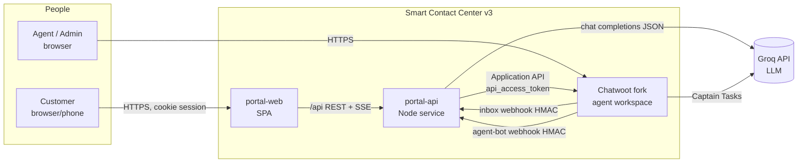
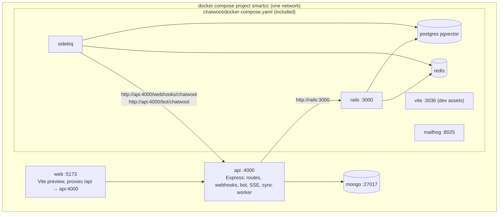
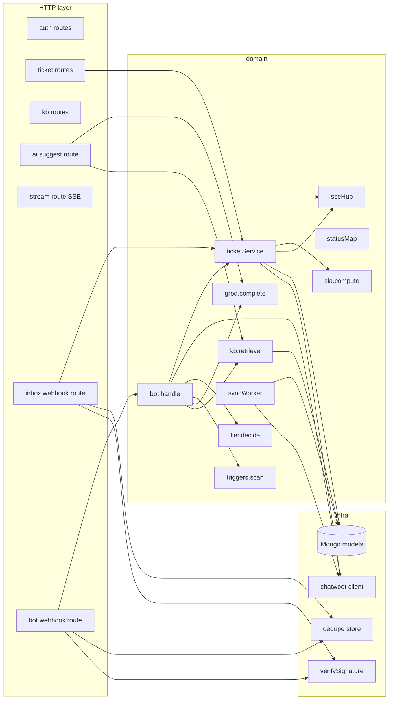
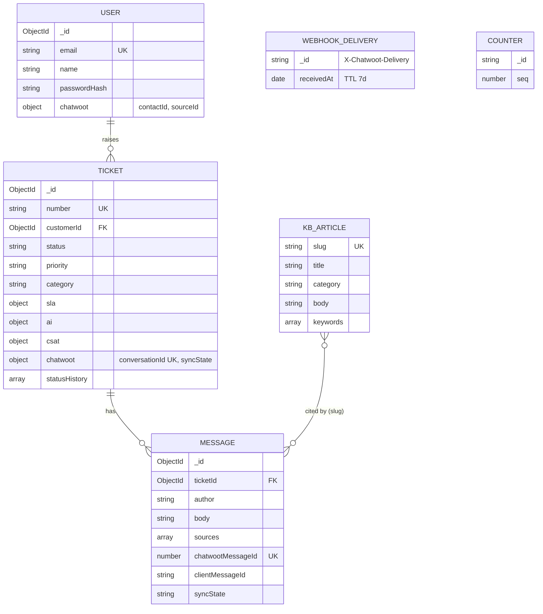

# HLD — Backend: Smart Contact Center v3 (Stage 3a)

Inputs: requirements.md v1.1 (scope fullstack), prd-review.md (APPROVED_WITH_FIXES), PLAN.md.
Note: the skill's `references/hld_template.md` / `domain_notes.md` are not present in the pack; section set below follows
the skill's required content (constraints → decisions → diagrams → bottlenecks → scaling roadmap). Inapplicable sections are listed as N/A with a reason (§20).

## 1. Assumptions & Constraints (drive every decision below)

| # | Constraint / assumption | Source |
|---|---|---|
| C1 | Single tenant, single region, pilot scale: 200 concurrent live customers, 50 tickets/h | REQ-047 |
| C2 | Team: 1 developer + AI agents; boring tech; fewest moving parts | PLAN §3 "one Node service" |
| C3 | Agent/admin UI = forked Chatwoot; integrate only via Application API, API-channel inbox webhook, Agent Bot webhook | PLAN §3, REQ-049 |
| C4 | AI = Groq OpenAI-compatible chat completions, JSON mode, plain `fetch` | PLAN §5 |
| C5 | Customer data store = MongoDB (Mongoose); in-memory Mongo for dev/test only | PLAN §5 |
| C6 | Everything starts with `docker compose up` | REQ-048 |
| C7 | Consistency: ticket state is eventually consistent with Chatwoot (seconds); Chatwoot is source of truth for conversation status/priority, portal is source of truth for SLA, CSAT, customer identity, KB | derived |
| A1 | Chatwoot inbox webhooks are **not retried** on failure (verified: `lib/webhooks/trigger.rb` only retries agent-bot 429/500) | Chatwoot source |
| A2 | Agent-bot webhook timeout is 5 s (`WEBHOOK_TIMEOUT` default); a failed/timeout `message_created` on a pending conversation makes Chatwoot open it (fallback hand-off) | Chatwoot source |
| A3 | Chatwoot outbound HTTP uses SSRF filter; private/Docker addresses blocked unless `SAFE_FETCH_ALLOW_PRIVATE_NETWORK=true` | `lib/safe_fetch.rb` |

## 2. System Context (C4 level 1)



## 3. Containers (C4 level 2)



Webhook deliveries are made by Sidekiq jobs (`WebhookJob`, `AgentBots::WebhookJob`), so the sidekiq container must reach `api`.

## 4. Architecture Style — Decision

**Modular monolith (one Node process)** with modules `auth`, `tickets`, `kb`, `chatwoot` (client + webhook), `ai` (retrieval, LLM, tier, bot), `sla`, `realtime` (SSE hub), `sync` (deferred delivery worker).
- Drivers: C1, C2, PLAN §3.
- Rejected: separate bot service — adds a network hop and deployment for no load reason; PLAN defers it until load needs it. Trigger to revisit: AI work > 30 % CPU or > 1 instance required (§19).
- Rejected: queue broker (Redis/BullMQ) for bot jobs — Chatwoot already queues delivery; in-process async + Chatwoot's own fallback-to-open (A2) covers crash during processing. Trigger to revisit: multi-instance API.

## 5. Component View (C4 level 3, portal-api)



## 6. Data Architecture

Datastore: MongoDB (C5). Why over Postgres: PLAN fixed it; documents (ticket with embedded SLA/AI/CSAT/history) match read pattern "load one ticket + its messages". Rejected alternative: reuse Chatwoot's Postgres — couples portal to Chatwoot schema/migrations (violates REQ-049).



Messages are a separate collection (not embedded) because two writers (bot path and webhook path) must upsert the same
message by `chatwootMessageId` under a unique index — impossible with an embedded array.

Retention: tickets/messages kept indefinitely (pilot); webhook deliveries TTL 7 days.

## 7. Integration Boundaries & Contracts (Chatwoot)

| Direction | Mechanism | Auth | Used for |
|---|---|---|---|
| api → Chatwoot | `POST /api/v1/accounts/:acc/contacts` | admin token | create contact (identifier = userId, inbox_id) → `contact_inbox.source_id` |
| api → Chatwoot | `GET …/contacts/search?q=<userId>` | admin token | fallback when contact create returns 422 (identifier taken, e.g. Mongo reset) — pick exact `identifier` match |
| api → Chatwoot | `POST …/conversations` `{source_id, inbox_id, contact_id, custom_attributes, message:{content, message_type:"incoming"}}` | admin token | mirror ticket (REQ-028); conversation starts `pending` because inbox has an active bot |
| api → Chatwoot | `POST …/conversations/:id/messages` `{content, message_type, private}` | admin (customer msgs, CSAT note) / bot (AI replies, notes) | |
| api → Chatwoot | `POST …/conversations/:id/toggle_status {status}` | bot token for pending→open (triggers `bot_handoff!`), admin token for resolve | |
| api → Chatwoot | `POST …/conversations/:id/toggle_priority {priority}` | bot | |
| api → Chatwoot | `POST …/conversations/:id/labels {labels[]}` (replaces list — caller merges) | bot | |
| api → Chatwoot | `POST …/conversations/:id/custom_attributes {custom_attributes, merge:true}` | bot / admin | panel data |
| api → Chatwoot | `GET …/conversations/:id`, `GET …/conversations/:id/messages` | admin | reconcile (REQ-045) |
| Chatwoot → api | Inbox webhook `POST /webhooks/chatwoot` (events: message_created, conversation_status_changed, conversation_updated, others ignored) | `X-Chatwoot-Signature: sha256=HMAC(inbox secret, "ts.body")`, `X-Chatwoot-Timestamp`, `X-Chatwoot-Delivery` | agent replies, status/priority/labels |
| Chatwoot → api | Agent-bot webhook `POST /bot/chatwoot` | same scheme, bot secret | trigger AI on incoming messages |

Bot-token endpoints are restricted by Chatwoot to `conversations#{show,toggle_status,toggle_priority,create,update,custom_attributes}`, `messages#create`, `labels#{index,create}`, `assignments#create` (`AccessTokenAuthHelper::BOT_ACCESSIBLE_ENDPOINTS`) — the design uses only those with the bot token.

## 8. Key Flows (sequence diagrams)

### 8.1 Create ticket (REQ-004, REQ-028)
```mermaid
sequenceDiagram
  participant B as Browser
  participant A as portal-api
  participant M as Mongo
  participant C as Chatwoot
  B->>A: POST /api/tickets (Idempotency-Key)
  A->>M: find ticket by (customerId, idempotencyKey)
  alt exists
    A-->>B: 201 existing ticket
  else new
    A->>M: counters.$inc → SC-1042; insert ticket(syncState=pending) + first message
    A->>C: ensure contact (cached on user) → create conversation(message incoming)
    alt Chatwoot OK
      A->>M: chatwoot.conversationId, syncState=synced, message.chatwootMessageId
    else error/timeout 10s
      A->>M: syncState=pending, attempts=1 (sync worker retries)
    end
    A-->>B: 201 ticket
  end
  C-->>A: (async) agent-bot webhook message_created → §8.2
```

### 8.2 Bot decision (REQ-016…023)
```mermaid
sequenceDiagram
  participant C as Chatwoot (sidekiq)
  participant A as portal-api /bot/chatwoot
  participant Q as per-ticket queue
  participant G as Groq
  participant M as Mongo
  C->>A: POST message_created (signed)
  A->>A: verify HMAC + ts ≤300s; dedupe delivery id
  A-->>C: 200 (immediately, < 50 ms)
  A->>A: filter: message_type=incoming && !private && conversation.status=pending
  A->>Q: enqueue(ticketId, run)
  Q->>M: load ticket + last 10 messages
  Q->>M: kb $text search top 3
  Q->>G: chat.completions JSON (timeout 20s, 1 retry on 429/5xx)
  G-->>Q: {intent,category,priority,confidence,triggers,answer,sources,summary}
  Q->>Q: validate; triggers ∪ keywordScan; priority floor; tier.decide()
  alt auto
    Q->>C: messages (outgoing, public) [bot token]
    Q->>M: upsert Message(ai, sources) by chatwootMessageId
  else draft / human
    Q->>C: messages (private note)
    Q->>C: toggle_status open [bot token → bot_handoff]
  end
  Q->>C: toggle_priority, labels(merged), custom_attributes(merge)
  Q->>M: ticket.ai, priority, sla, status
  Q->>A: sseHub.emit(customerId, ticket.updated / message.created)
```

### 8.3 Agent reply / status change (REQ-029, REQ-030)
```mermaid
sequenceDiagram
  participant AG as Agent
  participant C as Chatwoot
  participant A as portal-api /webhooks/chatwoot
  participant M as Mongo
  participant B as Browser (SSE)
  AG->>C: public reply / resolve / priority
  C->>A: message_created | conversation_status_changed | conversation_updated (signed)
  A->>A: verify + dedupe
  A->>M: find ticket by chatwoot.conversationId
  alt message_created outgoing & !private
    A->>M: upsert Message($setOnInsert) ; set sla.firstResponseAt if unset
    A->>B: event message.created
  else status/priority/labels
    A->>M: apply if event newer than ticket.chatwoot.lastEventAt
    A->>B: event ticket.updated
  end
  A-->>C: 200
```

### 8.4 Customer actions
- **Follow-up / reopen:** insert Message(customer, syncState pending) → `POST messages {message_type:"incoming"}` (admin) → Chatwoot reopens resolved conversations to `pending` (active bot) and snoozed to `open` itself (`Message#reopen_conversation`); status arrives back via webhook.
- **This solved it:** `toggle_status {status:"resolved"}` (admin); ticket resolved, `resolutionType=ai`.
- **Talk to a human:** private note (bot) + `toggle_status {status:"open"}` with **bot** token so Chatwoot runs `bot_handoff!` (clears AI assignee, sets waiting_since); set `ticket.ai.humanRequested=true`.
- **Close:** `toggle_status resolved` (admin).
- **CSAT:** store; `custom_attributes {csat}` merge + private note `CSAT n/5 — comment` (admin).

### 8.5 Deferred delivery (BR-SYNC-1) and reconcile (REQ-045)
- `syncWorker` (setInterval 30 s, single in-flight run): tickets with `chatwoot.syncState=pending` and `nextAttemptAt ≤ now` → create conversation; then customer messages with `syncState=pending` whose ticket is synced → post. Backoff: 30 s × 20 attempts, then 5 min. `failed` never set permanently; UI shows "Delayed" after 20 attempts.
- **Bot recovery sweep** (same 30 s tick): tickets with `status=ai_handling`, `ai.pendingSince` set and older than 60 s (set when a customer message is stored while AI-handling, cleared when a decision completes) → re-enqueue bot run. Covers api crash after acking the bot webhook.
- **SLA breach sweep** (every 2nd tick = 60 s, REQ-026): non-resolved tickets whose active due time < now and `sla.breachedAt` unset → set `breachedAt`, add Chatwoot label `sla-breached` (merged), emit `ticket.updated`.
- Reconcile on `GET /api/tickets/:number/messages` if `chatwoot.reconciledAt` older than 30 s: background fetch conversation + messages; upsert outgoing public messages; apply status/priority. Response is not delayed by reconcile; changes go out over SSE.

### 8.6 KB seed (REQ-036)
`api/src/seed/kb.js` exports ≥ 10 articles (from reference `seedData.js`, rewritten as plain text). On boot, if `kbarticles` is empty, upsert by `slug`; `npm run seed` forces upsert. Labels/custom attributes are seeded in Chatwoot by the setup script, not here.

## 9. API Design (overview; full contract in lld-backend.md)

REST/JSON under `/api`, cookie session, error envelope `{error:{code,message,details?}}`. Resource key = human ticket
number (`SC-1042`) — stable, shareable, avoids exposing Mongo ids. Writes that can be retried carry idempotency keys:
ticket create (`Idempotency-Key` header), message send (`clientMessageId`). No versioning prefix (single consumer, same repo); add `/api/v2` only on a breaking change.
Real-time: Server-Sent Events `GET /api/stream` (one-way server→client suffices; EventSource auto-reconnects; works through the Vite proxy). Rejected: WebSocket (bidirectional unused, extra lib), polling (fails REQ-042 at reasonable cost).

## 10. AI Component

| Aspect | Decision | Rationale / rejected |
|---|---|---|
| Model | Groq `GROQ_MODEL` default `openai/gpt-oss-120b`, temperature 0.2, `response_format: json_object`, max_tokens 800 | PLAN; JSON mode avoids tool-calling complexity |
| Retrieval | Mongo `$text` index on title(10)/keywords(5)/body(1), top 3 | PLAN "text index first". Rejected embeddings: 10–30 articles, keyword recall adequate; revisit if acceptance < 50 % |
| Guardrails in code | tier rule, citation subset check, trigger keyword union, priority floor, loop guard | Prompt injection cannot change tier logic (prd-review risk 2) |
| Failure | no key / timeout 20 s / 429 after one retry (honour `retry-after` ≤ 5 s) / invalid JSON → human tier | REQ-021 |
| Concurrency | in-process per-ticket promise chain | serialise decisions per ticket (BR-AI edge case) |
| Deflection | `POST /api/ai/suggest` reuses retrieval + LLM with "suggest" prompt; no ticket side effects | REQ-005 |
| Cost | ≤ 2 LLM calls per ticket typical (create + one follow-up); suggest rate-limited 20/min/user | |

## 11. Real-time

`sseHub`: `Map<userId, Set<Response>>`. Events: `message.created`, `ticket.updated`, comment ping every 25 s.
Single-process only (C1). Clients refetch on reconnect (no event replay store) — simpler than Last-Event-ID and correct because the REST API is the source of truth.

## 12. Security

| Concern | Control |
|---|---|
| Customer authn | bcrypt (cost 12) password hash; JWT HS256 (`sub`, `exp` 7 d) in `HttpOnly; SameSite=Lax; Path=/` cookie `scc_session`, `Secure` when `COOKIE_SECURE=true` |
| CSRF | SameSite=Lax + mutations require `Content-Type: application/json` + `Origin` must equal `WEB_ORIGIN` when present |
| Authz | every ticket query filters by `customerId = session.sub`; foreign ticket → 404 (no existence leak) |
| Webhook authenticity | HMAC-SHA256 over `"${ts}.${rawBody}"`, constant-time compare, `|now-ts| ≤ 300 s`, dedupe on delivery id; separate secrets for inbox and bot |
| Session revocation | JWT carries `pv` (password version = `user.passwordChangedAt` epoch s); auth middleware loads the user and rejects if mismatched → password change logs out other sessions |
| Client IP | `app.set('trust proxy', 1)`; web proxy sets `X-Forwarded-For` (`xfwd: true`) — otherwise every request appears to come from the web container and IP-based limits lock out everyone |
| Brute force | in-memory fixed-window limiter: login 10/15 min per (ip,email); register 5/h per ip; suggest 20/min per user; messages 30/min per user |
| Secrets | env only; never logged (logger redacts `authorization`, `api_access_token`, `cookie`, `password`) |
| LLM data | only the ticket's own thread + KB text sent; no other customer data (REQ-044) |
| XSS | API returns plain text; web renders as text nodes (no HTML) |
| Chatwoot tokens | admin token of a dedicated "Portal Service" administrator user; bot token from Agent Bot |

## 13. Reliability

| Failure | Behaviour |
|---|---|
| Chatwoot down on create/send | stored with `syncState=pending`; sync worker delivers (BR-SYNC-1) |
| api down during agent reply | webhook lost (A1) → reconcile on next ticket open (REQ-045) |
| api crash mid bot run | Chatwoot already got 200; conversation stays pending → customer can press "Talk to a human"; sync worker additionally re-runs bot for tickets `status=ai_handling` with last message from customer older than 60 s and no `ai.lastRunAt` after it (bot recovery sweep) |
| Duplicate webhook | delivery-id dedupe + unique `chatwootMessageId` + state-not-transition updates |
| Out-of-order events | apply conversation events only if `conversation.updated_at` ≥ `ticket.chatwoot.lastEventAt` |
| Groq 429/timeout | one retry then human tier |

## 14. Performance

Hot paths are single-document reads by indexed keys (`number`, `customerId+updatedAt`, `chatwoot.conversationId`, `ticketId+createdAt`). No N+1: list endpoint projects summary fields only. p95 ≤ 300 ms trivially at C1 scale. AI latency dominated by Groq (1–4 s) — within REQ-041.

## 15. Observability

- Structured JSON logs (one line per request: method, path, status, ms, userId?) via a ~15-line middleware; no logging library.
- Domain events as log lines (`evt` field) matching PRD tracking table: `ticket_created`, `ai_decision`, `ai_answer_accepted`, `suggestion_shown`, `csat_submitted`, `ticket_resolved`, `webhook_rejected`, `sync_retry`.
- `GET /healthz` → `{ok, mongo, chatwootReachable(cached 30 s), groqConfigured}`.
- Alerts: N/A for pilot (no monitoring stack); log grep is the operations tool. Revisit at production.

## 16. Deployment & Environments

- Root `docker-compose.yml`: `include: [chatwoot/docker-compose.yaml]` (Compose ≥ 2.20) + services `mongo`, `api`, `web`. One network → webhooks use `http://api:4000/...`; `host.docker.internal` only when api runs on the host (`npm run dev`).
- Chatwoot env (`chatwoot/.env`, from its `.env.example`): `SECRET_KEY_BASE`, `FRONTEND_URL=http://localhost:3000`, `REDIS_PASSWORD`, `ENABLE_ACCOUNT_SIGNUP=false`, **`SAFE_FETCH_ALLOW_PRIVATE_NETWORK=true`** (A3), `WEBHOOK_TIMEOUT` unset (5 s; bot acks immediately).
- First run: `docker compose run --rm rails bundle exec rails db:chatwoot_prepare`, then `node scripts/chatwoot-setup.mjs`.
- Setup (idempotent): (1) `rails runner scripts/chatwoot-bootstrap.rb` via `docker compose exec` — create account "SmartCC", admin user "Portal Service", print admin access token; set InstallationConfig `INSTALLATION_NAME`, `BRAND_NAME`, `CAPTAIN_OPEN_AI_API_KEY`, `CAPTAIN_OPEN_AI_ENDPOINT=https://api.groq.com/openai`, `CAPTAIN_OPEN_AI_MODEL` (InstallationConfig rows are seeded once, so yml edits alone don't update an existing DB). Rejected: Platform API — needs a platform app token which itself requires super-admin console work. (2) Application API: find-or-create API inbox "Customer Portal" (webhook_url), agent bot "SmartCC AI" (outgoing_url) + `set_agent_bot`, custom attribute definitions, labels. (3) Write ids/tokens/secrets into root `.env`.
- Fork: branch `smartcc` created from the release tag the clone resolves to (`v4.18.0` at time of writing), not `develop`; `upstream` remote kept; merges done tag-to-tag.
- Rollback: compose image tags + git; Mongo is additive (no migrations).

## 17. Configuration (env)
Full list in lld-backend.md §4.8. Required at boot: `MONGO_URL` (or `MONGO_MEMORY=1`), `JWT_SECRET`, `CHATWOOT_URL`, `CHATWOOT_ACCOUNT_ID`, `CHATWOOT_INBOX_ID`, `CHATWOOT_ADMIN_TOKEN`, `CHATWOOT_BOT_TOKEN`, `CHATWOOT_INBOX_SECRET`, `CHATWOOT_BOT_SECRET`. Optional: `GROQ_API_KEY` (absent → all human).

## 18. Chatwoot Fork Changes (REQ-031, REQ-033, REQ-034, REQ-049)
1. Branding: `config/installation_config.yml` defaults (INSTALLATION_NAME/BRAND_NAME "SmartCC"), `public/brand-assets/logo*.svg`.
2. Portal ticket panel: new `app/javascript/dashboard/routes/dashboard/conversation/PortalTicketPanel.vue`; entry `{ name: 'portal_ticket' }` in `DEFAULT_CONVERSATION_SIDEBAR_ITEMS_ORDER` (`composables/useUISettings.js`); accordion block in `ContactPanel.vue`; i18n key in `i18n/locale/en/conversation.json`. Reads `currentChat.custom_attributes` (`ticket_number`, `sla_due_at`, `ai_tier`, `ai_confidence`, `csat`) — no backend change.
3. Captain Tasks → Groq: configuration only (bootstrap step), feature `captain_tasks` is enabled by default and non-premium.

## 19. Scaling Roadmap

| Trigger | Change |
|---|---|
| > 1 api instance | SSE fan-out via Mongo change streams or Redis pub/sub; rate limiter & per-ticket queue to Redis; webhook dedupe already in Mongo |
| AI p95 > 15 s or Groq 429 > 5 % | separate bot worker with queue; model fallback |
| KB > 300 articles or auto-acceptance < 50 % | embeddings (Groq has none — would add an embedding provider) |
| Tickets > 1M | archive resolved tickets; current indexes suffice until then |

## 20. Sections N/A
Search engine (Mongo text index suffices), CDN (local/pilot), payments, IoT, streaming media, multi-region, i18n, offline sync, analytics/BI warehouse, multi-tenancy (A2), notifications by email/push (out of scope).

## 21. Bottlenecks & Risks (honest)

| # | Weakest link | Impact | Mitigation |
|---|---|---|---|
| 1 | Inbox webhooks not retried (A1) | missed replies while api down | reconcile on open (REQ-045) |
| 2 | Single-process SSE/limiter/queue | no horizontal scale | fine at C1; roadmap §19 |
| 3 | Chatwoot SSRF filter blocks Docker addresses | **no webhooks at all** if forgotten | `SAFE_FETCH_ALLOW_PRIVATE_NETWORK=true` in setup + healthcheck-style setup assertion (setup script posts a test message and waits for webhook) |
| 4 | Chatwoot 4 GB RAM, 10–15 min build | slow first start | documented |
| 5 | Labels API replaces list | agent labels lost on bot write | merge with `conversation.labels` from payload / GET before write |
| 6 | `custom_attributes` POST replaces unless `merge:true` | panel data wiped | always send `merge: true` |
