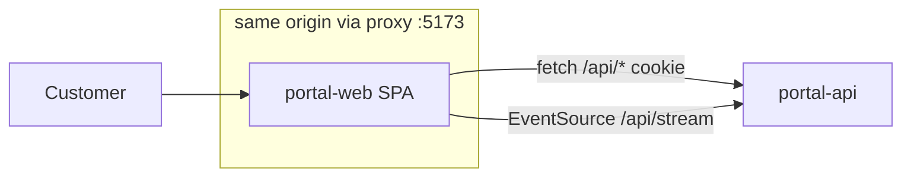

# HLD — Frontend: Customer Portal (Stage 3b)

Inputs: requirements.md v1.1, prd-review.md, hld-backend.md (API style, SSE, cookie session are hard constraints), PLAN.md §5/§7.
Note: the skill's `templates/`, `knowledge/`, `decision-matrices/` files are not in the pack; sections follow the skill's five-phase workflow.

## 1. Executive Summary
A mobile-first single-page app (React 18 + Vite + TypeScript, Tailwind, TanStack Query, React Router) for customers:
sign-in, Home, New ticket with live AI suggestion, live ticket thread, Help Center, Profile. Client-side rendered,
same-origin with the API through a proxy, cookie session, live updates over SSE patched into the query cache.
Visual direction "Paper & Signal": warm paper surfaces, ink typography, one ultramarine signal colour, a distinct violet
for AI, an SLA ring that reads like a countdown. Light/dark, WCAG 2.2 AA.

## 2. Assumptions
- F1 Authenticated app; only Help Center is public; no SEO requirement in pilot (Help Center indexed later if needed).
- F2 Primary device: phone (persona Priya); desktop secondary.
- F3 Evergreen browsers (last 2 versions Chrome/Safari/Firefox/Edge, iOS Safari 16+). `EventSource` universally available.
- F4 One developer; no design system exists — create a small token layer + ~12 primitives.
- F5 API and web served from the same origin (`/api` proxied) so the HttpOnly cookie works and SSE needs no CORS.

## 3. Requirements → Frontend capabilities

| REQ | Capability |
|---|---|
| 001/002 | Login, Register pages; auth guard; redirect-back |
| 003 | Profile page (name, password, theme) |
| 004/005 | New ticket page; debounced suggestion panel; idempotent submit |
| 006/025 | Home list with SLA ring chip, filter tabs |
| 007/008/022 | Thread: message list, composer with optimistic send, AI badge + sources |
| 009/010/011/012/013 | Ticket action bar; CSAT card |
| 014/015 | Status pill + timeline |
| 035 | Help Center list/search/article; "raise a ticket" prefill |
| 037 | Live event hook + reconnect refetch |
| 038/039/043 | Theme tokens, responsive shell, a11y patterns |
| 045 | Opening a thread calls messages endpoint (server reconciles) |

## 4. Architecture Decisions

| Decision | Choice | Why (for this system) | Rejected & why | Risk / at 10× |
|---|---|---|---|---|
| Framework | React 18 + TS + Vite | PLAN fixed; team familiarity | Next.js: SSR/SEO not needed (F1), adds server runtime | none |
| Rendering | CSR SPA | authenticated, interactive; API on same origin | SSR: no SEO need, more infra | first load: route-split, ~150 KB JS gz budget |
| Routing | React Router 6 data-less routes + `lazy()` per page | simple guards, code split | file-based routing frameworks — unnecessary | — |
| Server state | TanStack Query | caching, refetch on reconnect, optimistic mutations | Redux/RTK Query: heavier; hand-rolled fetch cache: reinvention | — |
| Client state | `useState` + 1 tiny context (theme) | only theme is global; session = `me` query | Zustand/Redux: no global client state to justify | — |
| Real-time | `EventSource('/api/stream')` in one hook at app shell; events patch query cache | one connection per tab; cache is single source | WebSocket: one-way need; polling: latency | 10× tabs fine; server limit §hld-backend 19 |
| Forms | native `<form>` + controlled inputs + small validators | ≤ 3 fields per form; server returns field errors | React Hook Form/zod in web: weight for 4 small forms | revisit if forms grow |
| Styling | Tailwind with CSS-variable tokens | speed + theming via variables | CSS-in-JS: runtime cost; CSS modules: slower to build | — |
| Icons | `lucide-react` (tree-shaken) | consistent stroke icons, small per-icon | icon fonts: a11y issues | — |
| Fonts | self-hosted `@fontsource-variable/bricolage-grotesque` (display) + `@fontsource-variable/figtree` (text) | distinctive, no third-party requests | Google Fonts CDN: privacy + extra origin | ~60 KB woff2, `font-display: swap` |
| Dates | `Intl.RelativeTimeFormat` / `Intl.DateTimeFormat` | native | date-fns/dayjs: not needed | — |
| Micro-frontends | No | one small app | — | — |

## 5. System Context (frontend view)



## 6. Routing

```mermaid
flowchart TD
  start((URL)) --> pub{public route?}
  pub -->|/login /register| Auth[AuthLayout]
  pub -->|/help /help/:slug| Shell[AppShell (works signed-out)]
  pub -->|no| guard{me query}
  guard -->|loading| Splash[Full-screen skeleton]
  guard -->|401| Redirect[/login?next=path/]
  guard -->|ok| Shell2[AppShell + LiveEvents]
  Shell2 --> Home[/ Home/]
  Shell2 --> New[/tickets/new/]
  Shell2 --> Thread[/tickets/:number/]
  Shell2 --> Profile[/profile/]
  Shell2 --> NF[* NotFound]
```

## 7. Auth Flow

```mermaid
sequenceDiagram
  participant B as Browser
  participant A as API
  B->>A: POST /api/auth/login {email,password}
  A-->>B: 200 {user} + Set-Cookie scc_session (HttpOnly)
  B->>B: queryClient.setQueryData(['me'], user); navigate(next ?? '/')
  B->>A: GET /api/stream (cookie)
  Note over B,A: any 401 from fetch wrapper → clear cache → /login?next=
  B->>A: POST /api/auth/logout
  A-->>B: 204 + clear cookie
  B->>B: EventSource.close(); queryClient.clear(); BroadcastChannel('scc').postMessage('logout')
```

Token never touches JS (HttpOnly). Cross-tab logout via `BroadcastChannel`.

## 8. Data Flow — live thread

```mermaid
sequenceDiagram
  participant UI as ThreadPage
  participant Q as QueryCache
  participant ES as useLiveEvents (EventSource)
  participant A as API
  UI->>Q: useTicket(number), useMessages(number)
  Q->>A: GET /api/tickets/SC-1042 , /messages
  ES-->>Q: message.created → append if id absent (dedupe by id / clientMessageId)
  ES-->>Q: ticket.updated → setQueryData(['ticket',n]) ; invalidate ['tickets']
  ES-->>Q: (re)open → invalidateQueries() (catch-up)
  UI->>Q: send → optimistic message (pending) → POST → replace with server message
```

## 9. Component Architecture

Layers: `pages` (route containers, own queries) → `features/*` (feature components + hooks) → `ui/*` (presentational primitives, no data). `lib/` holds api client, live events, formatters, validators.

Feature modules: `auth`, `tickets` (list, thread, composer, actions, csat, sla), `kb`, `profile`, `shell`.

## 10. Folder Structure (top level; full tree in LLD)
```
web/src/
  main.tsx  App.tsx  routes.tsx
  pages/        # one file per route
  features/     # auth, tickets, kb, profile, shell
  ui/           # Button, Input, Textarea, Card, Badge, Pill, Tabs, Dialog, Skeleton, Toast, EmptyState, SlaRing
  lib/          # api.ts, live.ts, types.ts, format.ts, validate.ts, theme.tsx
  styles/       # tokens.css, index.css
```

## 11. Visual Design Direction — "Paper & Signal"

- **Mood:** calm, trustworthy, human; a support desk that feels like good stationery, not a dashboard.
- **Surfaces:** warm paper background (`#F6F4EE` light / `#0D0F15` dark), white cards with 1 px hairlines, generous radius (14 px cards, 999 px pills).
- **Type:** Bricolage Grotesque for headings and ticket numbers (characterful, compressed width suits mobile headings); Figtree for text (high x-height, legible at 15–16 px). Tabular numerals for countdowns.
- **Colour roles:** one signal colour (ultramarine `#3D35C8` / `#A9A6FF` dark) for primary actions and focus; AI is violet (`#6D28D9` / `#C4B5FD`) and appears only on AI content; status colours only with icon + text.
- **Signature elements:** (1) **SLA ring** — circular progress around a clock icon with "12m left"/"Breached 5m ago" text; (2) **AI message card** — violet left rail, "AI assistant" badge, collapsible "Based on 2 articles" source chips; (3) **status rail** — vertical timeline dots on the thread side (desktop) / collapsible strip (mobile); (4) suggestion panel on New ticket that slides under the description like a margin note.
- **Motion:** 150–200 ms ease-out for message arrival and panel reveal; disabled under `prefers-reduced-motion`.
- Exact tokens in lld-frontend.md §19 (contrast-checked).

## 12. Responsive Strategy (mobile-first)
- < 768 px: single column; bottom tab bar (Home, Help, New, Profile) with safe-area inset; thread composer sticky at bottom, follows `visualViewport` for keyboard.
- 768–1279 px: top bar + content max-width 720 px.
- ≥ 1280 px: left sidebar nav; thread page two columns (conversation 1fr | 320 px details: SLA, status rail, actions).
- Pattern changes: ticket list rows → cards < 768; status rail column → collapsible strip < 1280.

## 13. Performance
Budgets: initial JS ≤ 150 KB gz, LCP ≤ 2.5 s (REQ-040). Levers: route-level `lazy()`; fonts subset latin + swap; no chart/editor libs; thread list renders plainly (≤ 500 messages cap server-side, no virtualization needed — a ticket rarely exceeds 50 messages); suggestion debounced 800 ms with AbortController.

## 14. Security
HttpOnly cookie (no token in JS/storage); all user/agent text rendered as React text (no `dangerouslySetInnerHTML`); URLs in messages not auto-linked (no `javascript:` risk); KB article body plain text paragraphs; `next` redirect param accepted only if it starts with `/` and not `//`; CSRF handled by SameSite=Lax + JSON content type (server) — fetch wrapper always sends `Content-Type: application/json`.

## 15. Accessibility (WCAG 2.2 AA, REQ-043)
Landmarks (`header`, `nav`, `main`); skip link; visible 2 px focus ring (signal colour, ≥ 3:1); thread is `role="log" aria-live="polite"`; SLA state text + icon; dialogs use native `<dialog>` with focus return; rating uses radio group; touch targets ≥ 44 px; reduced motion; form errors linked via `aria-describedby`; route change moves focus to page `<h1>` and announces title.

## 16. Observability
- Errors: a root error boundary renders a recovery screen and `console.error`s; no error-tracking service in pilot (documented gap, add Sentry-style reporting at production).
- Product events are derived server-side, no client analytics: `suggestion_shown` logged by `/api/ai/suggest`; `compose_abandoned_after_suggestion` = a suggestion with no ticket from that user within 30 min (computed from logs); `ai_answer_accepted`, `csat_submitted` logged by their endpoints.
- Web vitals: measured in e2e/Lighthouse runs only (pilot).

## 17. Deployment
Docker service `web`: `node:22-alpine`, `npm ci && npm run build && npx vite preview --host 0.0.0.0 --port 5173` with `preview.proxy` `/api → {target:'http://api:4000', xfwd:true}` (client IP for rate limits) (SSE passes through; proxy configured without buffering). Dev: `vite` with same proxy to `http://localhost:4000`.

## 18. Risks
| Risk | Mitigation |
|---|---|
| Vite preview proxy buffering SSE | send `X-Accel-Buffering: no`, flush headers; e2e asserts live update |
| Duplicate optimistic + SSE message | dedupe by `clientMessageId` |
| Stale UI after laptop sleep | EventSource reopen → invalidate all queries |
| Font weight on 3G | swap + subset |
