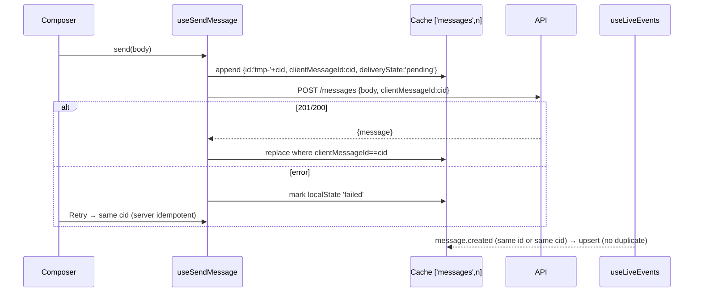

# LLD — Frontend: Customer Portal `web/` (Stage 5b)

Baseline: requirements.md v1.1 · hld-frontend.md (post-review) · lld-backend.md §4 (API contract is authoritative).

## 1. Executive Summary
React 18 + TypeScript (strict) SPA built with Vite, Tailwind over CSS-variable tokens, TanStack Query for all server
state, React Router 6 with lazy pages, one `EventSource` per tab feeding the query cache. No global client store; theme
is the only app-wide client state. Visual direction "Paper & Signal" (hld-frontend §11).
Assumptions: same-origin `/api` via Vite proxy (F5); session cookie is HttpOnly so the app learns auth state only from `GET /api/auth/me`.

## 2. Functional Requirements (→ REQ)
| # | Capability | REQ |
|---|---|---|
| FR1 | Register, sign in, sign out, redirect-back | 001, 002 |
| FR2 | Profile name/password/theme | 003, 038 |
| FR3 | New ticket with live suggestion and idempotent submit | 004, 005 |
| FR4 | Home list with filter, SLA chips, empty state | 006, 025 |
| FR5 | Thread live, author labels, AI badge + sources | 007, 022, 037 |
| FR6 | Composer with optimistic send/retry; reopen by sending | 008, 012 |
| FR7 | Actions: This solved it / Talk to a human / Close | 009, 010, 011 |
| FR8 | CSAT card | 013 |
| FR9 | Status pill + timeline + delivery banner (Queued/Delayed) | 004, 014, 015 |
| FR10 | Help Center: categories, search, article, "raise a ticket" prefill | 035 |
| FR11 | Live updates + reconnect catch-up; thread open triggers reconcile | 037, 045 |
| FR12 | Responsive, themed, accessible | 038, 039, 043 |

## 3. Non-Functional Requirements
Initial JS ≤ 150 KB gz; LCP ≤ 2.5 s mid phone 4G (REQ-040); live update render ≤ 200 ms after event (part of REQ-042 5 s); WCAG 2.2 AA (REQ-043); last-2 evergreen browsers + iOS Safari 16+; 360 px min width (REQ-039).

## 4. Architecture Decisions
| Area | Decision | Rationale | Rejected |
|---|---|---|---|
| Architecture | feature-based folders + shared `ui/` + `lib/` | 5 features share primitives | flat components dir (mixes concerns) |
| Components | pages = containers (own queries); features = presentational + feature hooks | testable without network | HOCs |
| Server state | TanStack Query v5 | cache, retries, optimistic | Redux/RTK Query |
| SSE | `useLiveEvents` at shell patches cache | single connection, cache = truth | per-page EventSource (N connections) |
| Global client state | `ThemeContext` only | auth = `['me']` query | Zustand |
| Forms | controlled inputs + `lib/validate.ts` + server `details[]` mapping | ≤ 3 fields/form | React Hook Form |
| Styling | Tailwind 3 utilities referencing CSS variables (`bg-surface`, `text-ink`) | theming via `data-theme` + media query | CSS-in-JS |
| Dialog | native `<dialog>` | built-in focus trap/escape | headless UI lib |
| Rating | native radio group | a11y for free | custom star widget |

## 5. Component Hierarchy

```mermaid
graph TD
  App[App: QueryClientProvider, ThemeProvider, RouterProvider] --> AuthLayout
  App --> AppShell["AppShell (C): useLiveEvents, ErrorBoundary"]
  AuthLayout --> LoginPage["LoginPage (C)"] --> AuthForm["AuthForm (P)"]
  AuthLayout --> RegisterPage["RegisterPage (C)"] --> AuthForm
  AppShell --> TopBar["TopBar (P)"] --> ThemeToggle["ThemeToggle (C: theme ctx)"]
  AppShell --> SideNav["SideNav (P) ≥1280"]
  AppShell --> BottomTabs["BottomTabs (P) <768"]
  AppShell --> HomePage["HomePage (C): useTickets"]
  HomePage --> FilterTabs["SegmentedControl (P)"]
  HomePage --> TicketList["TicketList (P)"] --> TicketCard["TicketCard (P)"]
  TicketCard --> StatusPill["StatusPill (P)"]
  TicketCard --> SlaChip["SlaChip (P) → SlaRing"]
  HomePage --> KbSearchBox["KbSearchBox (C)"]
  HomePage --> EmptyState["EmptyState (P)"]
  AppShell --> NewTicketPage["NewTicketPage (C): useCreateTicket"]
  NewTicketPage --> NewTicketForm["NewTicketForm (P)"]
  NewTicketPage --> SuggestionPanel["SuggestionPanel (C): useSuggestion"] --> SourceChips["SourceChips (P)"]
  AppShell --> TicketPage["TicketPage (C): useTicket, useMessages"]
  TicketPage --> TicketHeader["TicketHeader (P)"]
  TicketPage --> DeliveryBanner["DeliveryBanner (P)"]
  TicketPage --> Thread["Thread (P) role=log"] --> MessageBubble["MessageBubble (P)"]
  Thread --> AiMessage["AiMessage (P)"] --> SourceChips
  TicketPage --> TicketActions["TicketActions (C): useTicketAction"] --> ConfirmDialog["ConfirmDialog (P)"]
  TicketPage --> CsatCard["CsatCard (C): useRateTicket"]
  TicketPage --> Composer["Composer (C): useSendMessage"]
  TicketPage --> DetailsPanel["DetailsPanel (P): SlaChip, StatusTimeline"]
  AppShell --> HelpPage["HelpPage (C): useKbArticles"] --> CategoryGrid["CategoryGrid (P)"]
  HelpPage --> ArticleList["ArticleList (P)"]
  AppShell --> ArticlePage["ArticlePage (C): useKbArticle"]
  AppShell --> ProfilePage["ProfilePage (C)"] --> ProfileForm["ProfileForm (P)"]
  ProfilePage --> PasswordForm["PasswordForm (P)"]
```

(C) container · (P) presentational.

## 6. Folder Structure
```
web/
  index.html                    # root, <html data-theme> set by inline pre-paint script
  vite.config.ts                # react plugin; server/preview proxy /api → API (xfwd, SSE-safe)
  tailwind.config.ts            # maps tokens → utilities
  postcss.config.js             # tailwind + autoprefixer
  tsconfig.json                 # strict, noUncheckedIndexedAccess
  Dockerfile                    # build + vite preview :5173
  src/
    main.tsx                    # providers + router mount
    routes.tsx                  # route table, lazy pages, guards
    styles/tokens.css           # CSS variables light/dark (§19)
    styles/index.css            # tailwind layers, base, focus ring, reduced motion
    lib/api.ts                  # fetch wrapper, ApiError, typed endpoint functions
    lib/types.ts                # DTO types (mirror lld-backend §4.2)
    lib/queryClient.ts          # QueryClient defaults + 401 handling
    lib/live.ts                 # useLiveEvents (EventSource → cache)
    lib/cache.ts                # upsertMessage, putTicket helpers (pure)
    lib/format.ts               # dates, countdown, labels
    lib/validate.ts             # field validators
    lib/theme.tsx               # ThemeProvider, useTheme
    lib/useNow.ts               # ticking clock hook
    lib/useDebounced.ts         # debounce value hook
    ui/Button.tsx Input.tsx Textarea.tsx Select.tsx Card.tsx Badge.tsx Pill.tsx
    ui/SegmentedControl.tsx Dialog.tsx Skeleton.tsx Toast.tsx EmptyState.tsx SlaRing.tsx Field.tsx
    features/auth/{hooks.ts, AuthForm.tsx, RequireAuth.tsx}
    features/shell/{AppShell.tsx, TopBar.tsx, SideNav.tsx, BottomTabs.tsx, ThemeToggle.tsx, ErrorBoundary.tsx}
    features/tickets/{hooks.ts, TicketList.tsx, TicketCard.tsx, StatusPill.tsx, PriorityTag.tsx, SlaChip.tsx,
                      Thread.tsx, MessageBubble.tsx, AiMessage.tsx, SourceChips.tsx, Composer.tsx, TicketActions.tsx,
                      CsatCard.tsx, StatusTimeline.tsx, DetailsPanel.tsx, DeliveryBanner.tsx, TicketHeader.tsx,
                      NewTicketForm.tsx, SuggestionPanel.tsx}
    features/kb/{hooks.ts, CategoryGrid.tsx, ArticleList.tsx, KbSearchBox.tsx}
    features/profile/{ProfileForm.tsx, PasswordForm.tsx}
    pages/{LoginPage, RegisterPage, HomePage, NewTicketPage, TicketPage, HelpPage, ArticlePage, ProfilePage, NotFoundPage}.tsx
  test/                          # vitest + RTL (setup.ts, *.test.tsx)
```

## 7. Component Specifications

| Component | Props | State | Behaviour / events |
|---|---|---|---|
| RequireAuth | `{children}` | — | `useMe()`: loading → `<Splash/>`; 401 → `<Navigate to={'/login?next='+encodeURIComponent(path)}/>`; ok → children |
| AuthForm | `{mode:'login'\|'register'; onSubmit(v):Promise<void>; error?:ApiError}` | field values, touched | validates on blur + submit; maps `error.details[].path` to fields; submit disabled while pending |
| AppShell | — | — | mounts `useLiveEvents()` when signed in; layout by breakpoint; skip link; `<main id="main" tabIndex={-1}>` |
| TicketCard | `{t:TicketSummary; now:number}` | — | whole card is a link to `/tickets/:number`; shows number, subject (2-line clamp), StatusPill, PriorityTag, SlaChip |
| StatusPill | `{status:Status}` | — | icon + label: Sparkles "AI handling", UserRound "In progress", Hourglass "Waiting on you", CheckCircle "Resolved" |
| SlaChip | `{sla:Sla; now:number; size?:'sm'\|'md'}` | — | SlaRing fraction = remaining/window; text "12m left"/"At risk · 4m"/"Breached 3m ago"/"Met"; `aria-label` full sentence |
| SlaRing | `{fraction:number; tone:'ok'\|'warn'\|'bad'\|'done'}` | — | SVG 20/28 px; `aria-hidden` (chip carries text) |
| Thread | `{messages:UiMessage[]; onRetry(id)}` | — | `<ol role="log" aria-live="polite" aria-relevant="additions">`; groups by day; autoscroll to bottom only if user was within 120 px of bottom, else shows "New message ↓" button |
| MessageBubble | `{m:UiMessage; onRetry?}` | — | customer right-aligned (accent-soft), agent left (surface), system centered muted; delivery: "Sending…", "Not delivered · Retry" button |
| AiMessage | `{m:UiMessage}` | `sourcesOpen` | violet rail, Badge "AI assistant", body, disclosure button "Based on N articles" → SourceChips |
| SourceChips | `{sources:{slug,title}[]}` | — | links `/help/:slug` (open in same tab, state `from` ticket) |
| Composer | `{disabled:boolean; onSend(body):void; placeholder}` — `disabled` only while the ticket query is loading; enabled in every status (sending on a resolved ticket reopens it, placeholder "Reply to reopen this ticket") | text | textarea autosize ≤ 6 rows; Enter = newline on touch, Ctrl/Cmd+Enter sends; counter at > 4500; sticky bottom on mobile with `env(safe-area-inset-bottom)` |
| TicketActions | `{actions:TicketActions; onAction(a)}` | `confirming` | buttons: "This solved it" (primary) if canAccept; "Talk to a human" if canRequestHuman; "Close ticket" (ghost, confirm dialog) if canResolve |
| CsatCard | `{canRate; csat; onRate(r,c)}` | rating, comment | radiogroup 1–5 labelled "Very poor … Excellent"; submit; after success shows "Thanks — you rated 4/5" |
| StatusTimeline | `{events:StatusEvent[]}` | — | `<ol>` with time + actor; desktop column, mobile `<details>` "Status history" |
| DeliveryBanner | `{delivery:'synced'\|'queued'\|'delayed'}` | — | queued: info "Queued — our team will see it shortly"; delayed: warning "Delayed — we're retrying" ; synced → null |
| NewTicketForm | `{initial?:{subject?}; pending; error; onSubmit(v); onChange(v)}` | fields | category `<select>` optional ("Not sure"); validation per §14 |
| SuggestionPanel | `{subject; description}` | — | `useSuggestion`; states §12; "This answers my question" → navigate `/help/:slug` of first source or Home (no ticket); never blocks submit |
| SegmentedControl | `{name; value; options:{value,label}[]; onChange}` | — | native radios in `<fieldset>` with legend (visually hidden) |
| Dialog | `{open; title; onClose; children}` | ref | `showModal()`/`close()`; focus returns to opener |
| ThemeToggle | — | — | cycles System → Light → Dark; `aria-label="Theme: System"` |
| ErrorBoundary | `{children}` | error | fallback "Something went wrong" + Reload; per-route boundary wraps page |

## 8. Type Definitions (`lib/types.ts`) — mirror lld-backend §4.2 exactly
```ts
export type Status = 'ai_handling' | 'in_progress' | 'waiting_on_customer' | 'resolved';
export type Priority = 'low' | 'medium' | 'high' | 'critical';
export type Category = 'Account' | 'Billing' | 'Technical' | 'Commerce & Trade' | 'Compliance & GST' | 'Logistics & Orders' | 'General';
export type Trigger = 'fraud'|'security'|'legal'|'angry_customer'|'payment_dispute'|'account_takeover'|'repeated_issue'|'critical_incident';
export type SlaState = 'on_track' | 'at_risk' | 'breached' | 'met';
export interface User { id: string; name: string; email: string; createdAt: string }
export interface Sla { responseDueAt: string; resolutionDueAt: string; firstResponseAt: string | null;
  resolvedAt: string | null; activeDueAt: string | null; state: SlaState }
export interface TicketSummary { number: string; subject: string; status: Status; priority: Priority; category: Category;
  createdAt: string; updatedAt: string; lastMessageAt: string; sla: Sla; aiTier: 'auto'|'draft'|'human'|null;
  delivery: 'synced'|'queued'|'delayed' }
export interface StatusEvent { status: Status; at: string; by: 'customer'|'agent'|'ai'|'system' }
export interface TicketActions { canAccept: boolean; canRequestHuman: boolean; canResolve: boolean; canRate: boolean }
export interface TicketDetail extends TicketSummary { description: string; customerCategory: Category | null;
  resolutionType: 'ai'|'human'|null; csat: { rating: number; comment: string; submittedAt: string } | null;
  statusHistory: StatusEvent[]; ai: { confidence: number | null; triggers: Trigger[] }; actions: TicketActions }
export interface Source { slug: string; title: string }
export interface Message { id: string; ticketNumber: string; author: 'customer'|'agent'|'ai'|'system'; authorName: string;
  body: string; sources: Source[]; createdAt: string; clientMessageId: string | null; deliveryState: 'sent'|'pending' }
/** View model: adds client-only failure state for optimistic sends */
export type UiMessage = Message & { localState?: 'failed' };
export interface KbArticleSummary { slug: string; title: string; category: Category; excerpt: string; updatedAt: string }
export interface KbArticle extends KbArticleSummary { body: string }
export interface Suggestion { answer: string | null; confidence: number | null; sources: Source[]; articles: KbArticleSummary[] }
export interface Page<T> { items: T[]; nextCursor: string | null }
export interface ApiErrorBody { error: { code: ErrorCode; message: string; details?: { path: string; message: string }[] | Record<string, unknown> } }
export type ErrorCode = 'VALIDATION_FAILED'|'WRONG_PASSWORD'|'UNAUTHENTICATED'|'INVALID_CREDENTIALS'|'FORBIDDEN_ORIGIN'|'NOT_FOUND'
  |'EMAIL_TAKEN'|'INVALID_STATE'|'ALREADY_RATED'|'UNSUPPORTED_MEDIA_TYPE'|'RATE_LIMITED'|'INTERNAL';
export type LiveEvent = { type: 'message.created'; ticketNumber: string; message: Message }
                      | { type: 'ticket.updated'; ticket: TicketDetail };
```
No mapping layer: DTOs are already UI-shaped (single consumer); `UiMessage` is the only view model.

## 9. State Management
| Slice | Kind | Owner | Mutated by | Re-renders |
|---|---|---|---|---|
| current user | server `['me']` | Query | login/register/logout/profile mutations, 401 handler | shell, guards |
| ticket lists | server `['tickets', scope]` (infinite) | Query | invalidated on ticket.updated / create | HomePage |
| ticket detail | server `['ticket', number]` | Query | `setQueryData` from SSE ticket.updated and action responses | TicketPage |
| messages | server `['messages', number]` (`UiMessage[]`) | Query | optimistic send, SSE upsert | Thread |
| KB | server `['kb', {q, category}]`, `['kb','article',slug]` | Query (staleTime 10 min) | — | Help pages |
| suggestion | server `['suggest', debouncedSubject, debouncedDescription]` | Query (enabled when desc ≥ 20) | — | SuggestionPanel |
| theme | global client | ThemeContext + localStorage `scc-theme` | ThemeToggle, Profile | root `data-theme` |
| form fields | local | form components | typing | form |
| idempotency key | local `useRef(crypto.randomUUID())` | NewTicketPage | rotated after success | — |
| composer text | local | Composer | typing; cleared on send | Composer |
| live connection status | local in `useLiveEvents` → exposed via tiny context for a "Reconnecting…" toast | AppShell | EventSource events | Toast |
| now (clock) | local `useNow(30_000)` per page | pages | interval | SLA chips |

QueryClient defaults: `staleTime 30 s`, `retry: (n, e) => !(e instanceof ApiError && e.status < 500) && n < 2`, `refetchOnWindowFocus: true`.

## 10. Custom Hooks
| Hook | Input → Output | Wraps |
|---|---|---|
| `useMe()` | → `UseQueryResult<User>` (`retry:false`) | GET /api/auth/me |
| `useLogin()`, `useRegister()` | mutation(v) → sets `['me']` | E2/E1 |
| `useLogout()` | → clears cache, closes ES, `BroadcastChannel('scc').postMessage('logout')` | E3 |
| `useUpdateName()`, `useChangePassword()` | mutations | E5/E6 |
| `useTickets(scope)` | → infinite query pages `Page<TicketSummary>`; `getNextPageParam: p => p.nextCursor` | E7 |
| `useTicket(number)` | cache holds `{ticket}` (raw response); `select: r => r.ticket` → `TicketDetail` | E9 |
| `useMessages(number)` | → `UiMessage[]` (queryFn returns `r.items`, so the cache holds a plain array — required by `upsertMessage` in live.ts) | E10 |
| `useCreateTicket()` | `{subject,description,category,idemKey}` → `{ticket,messages}`; seeds `['ticket']`,`['messages']`; invalidates `['tickets']` | E8 |
| `useSendMessage(number)` | `body` → optimistic (§11) | E11 |
| `useTicketAction(number)` | `'accept'\|'handoff'\|'resolve'` → `setQueryData(['ticket'])`, invalidate lists | E12–E14 |
| `useRateTicket(number)` | `{rating, comment}` | E15 |
| `useSuggestion(subject, description)` | debounced 800 ms; `queryFn({signal})` passes AbortSignal (stale requests cancelled) | E18 |
| `useKbArticles({q, category})`, `useKbArticle(slug)` | | E16/E17 |
| `useLiveEvents()` | → `{status:'connecting'\|'open'\|'reconnecting'}` | EventSource |
| `useNow(ms)` | → `number` | setInterval |
| `useDebounced(v, ms)` | → debounced value | setTimeout |

## 11. API Contracts (consumed; source of truth lld-backend §4)
`lib/api.ts`:
```ts
export class ApiError extends Error { constructor(public status: number, public code: ErrorCode, message: string,
  public details?: ApiErrorBody['error']['details'], public retryAfterS?: number) { super(message) } }
async function req<T>(method: string, path: string, body?: unknown, headers?: Record<string,string>, signal?: AbortSignal): Promise<T> {
  const res = await fetch(`/api${path}`, { method, credentials: 'same-origin', signal,
    headers: { ...(body !== undefined ? { 'Content-Type': 'application/json' } : {}), ...headers },
    body: body !== undefined ? JSON.stringify(body) : undefined });
  if (res.status === 204) return undefined as T;
  const json = await res.json().catch(() => null);
  if (!res.ok) { const e = (json as ApiErrorBody | null)?.error;
    throw new ApiError(res.status, e?.code ?? 'INTERNAL', e?.message ?? 'Something went wrong', e?.details,
      Number(res.headers.get('Retry-After')) || undefined); }
  return json as T;
}
```
| Fn | Endpoint | Request | Response | Errors handled in UI |
|---|---|---|---|---|
| register | POST /auth/register | `{name,email,password}` | `{user:User}` | VALIDATION_FAILED (fields), EMAIL_TAKEN (email field), RATE_LIMITED (toast) |
| login | POST /auth/login | `{email,password}` | `{user}` | INVALID_CREDENTIALS (form-level), RATE_LIMITED |
| logout | POST /auth/logout | `{}` | 204 | — |
| me | GET /auth/me | — | `{user}` | 401 → guard |
| updateName | PATCH /me | `{name}` | `{user}` | VALIDATION_FAILED |
| changePassword | POST /me/password | `{currentPassword,newPassword}` | 204 | WRONG_PASSWORD (field) |
| listTickets | GET /tickets?scope&limit=20&before | — | `Page<TicketSummary>` | generic |
| createTicket | POST /tickets + `Idempotency-Key` | `{subject,description,category\|null}` | `{ticket:TicketDetail, messages:Message[]}` | VALIDATION_FAILED, RATE_LIMITED |
| getTicket | GET /tickets/:n | — | `{ticket}` | NOT_FOUND → not-found view |
| getMessages | GET /tickets/:n/messages | — | `{items:Message[]}` | NOT_FOUND |
| sendMessage | POST /tickets/:n/messages | `{body, clientMessageId}` | `{message}` | any → bubble failed + Retry |
| accept/handoff/resolve | POST /tickets/:n/{accept\|handoff\|resolve} | `{}` | `{ticket}` | INVALID_STATE → refetch ticket + toast "This ticket changed — refreshed" |
| rate | POST /tickets/:n/csat | `{rating, comment}` | `{ticket}` | ALREADY_RATED / INVALID_STATE → refetch + toast |
| kbList | GET /kb/articles?q&category | — | `{items:KbArticleSummary[]}` | generic |
| kbArticle | GET /kb/articles/:slug | — | `{article:KbArticle}` | NOT_FOUND view |
| suggest | POST /ai/suggest | `{subject, description}` | `Suggestion` | any → panel hidden silently (never blocks) |
| stream | GET /stream (EventSource) | — | events `message.created`, `ticket.updated` | onerror → reconnecting |

Every mutation sends a JSON body (empty `{}` for actions) so the server's JSON content-type guard passes.

## 12. Data Flow

**Optimistic send**

`lib/cache.ts`:
```ts
export function upsertMessage(list: UiMessage[] = [], m: Message): UiMessage[] {
  const i = list.findIndex(x => x.id === m.id || (m.clientMessageId && x.clientMessageId === m.clientMessageId));
  if (i === -1) return [...list, m].sort((a, b) => a.createdAt.localeCompare(b.createdAt));
  const copy = list.slice(); copy[i] = m; return copy;
}
```
**Live events (`lib/live.ts`)**
```ts
useEffect(() => {
  if (!user) return;
  const es = new EventSource('/api/stream');
  es.onopen = () => { setStatus('open'); if (wasOpen.current) qc.invalidateQueries(); wasOpen.current = true; };
  es.onerror = () => setStatus('reconnecting');            // browser auto-reconnects (server sends retry: 3000)
  es.addEventListener('message.created', e => { const d = JSON.parse(e.data);
    qc.setQueryData(['messages', d.ticketNumber], (l?: UiMessage[]) => l && upsertMessage(l, d.message)); });
  es.addEventListener('ticket.updated', e => { const { ticket } = JSON.parse(e.data);
    qc.setQueryData(['ticket', ticket.number], { ticket }); qc.invalidateQueries({ queryKey: ['tickets'] }); });
  return () => es.close();
}, [user?.id]);
```
If the stream returns 401 (session expired) the browser keeps retrying; `onerror` + a `me` refetch (every 60 s while reconnecting) sends the user to login.

## 13. User Flow
Sign in → Home (open tickets, SLA chips) → "New ticket" → type subject/description → suggestion panel shows answer + sources → Submit → Thread (`/tickets/SC-1042`) shows description bubble, status AI handling, SLA chip → AI message arrives live → "This solved it" → status Resolved, CsatCard → rate → thanks. Alternate: "Talk to a human" → system message + In progress → agent reply arrives live → agent resolves → CsatCard.

## 14. Validation Rules (client mirrors server; server is authoritative)
| Field | Rule | Message | Timing |
|---|---|---|---|
| name | trim 2–80 | "Enter 2–80 characters" | blur + submit |
| email | `type=email` + `/^[^\s@]+@[^\s@]+\.[^\s@]+$/`, ≤ 254 | "Enter a valid email" | blur + submit |
| password / newPassword | 8–128 | "Use at least 8 characters" | blur + submit |
| subject | trim 5–120 | "Subject needs 5–120 characters" | blur + submit |
| description | trim 20–5000 | "Describe the issue in at least 20 characters" | blur + submit; live counter |
| message body | trim 1–5000 | send disabled when empty | live |
| csat comment | ≤ 1000 | counter | live |
Server `details[].path` overrides client messages on the same field.

## 15a. UI States (every async view)
| View | Loading | Empty | Error | Other |
|---|---|---|---|---|
| Home list | 3 card skeletons | EmptyState "No open tickets" + Raise a ticket + KB search | inline Retry block | Resolved/All filter empty → "Nothing here yet" |
| TicketPage | header + 4 bubble skeletons | (n/a — ticket always has first message) | 404 panel / Retry block | Queued/Delayed banner; Reconnecting toast |
| Thread (AI pending) | — | — | — | typing-style "AI assistant is reviewing…" row while status ai_handling, last message customer, and < 30 s old |
| SuggestionPanel | shimmer line "Looking for an answer…" | hidden when no articles | hidden (never blocks) | articles-only variant when `answer=null` |
| Help list | skeleton list | "No articles match" + Raise a ticket (`?subject=`) | Retry | — |
| Article | skeleton paragraphs | — | 404 panel | — |
| Profile forms | button spinner | — | field/inline error | success toast |
| CSAT | button spinner | — | toast | thanks state |

Countdown text (`format.countdown(ms)`): ≥ 1 h → "2h 10m left"; ≥ 1 m → "12m left"; < 1 m → "<1m left"; past → "Breached 3m ago"; resolved → "Met" / "Missed".

## 15. Error Handling
| Category | Where | UX |
|---|---|---|
| 401 UNAUTHENTICATED (any query/mutation except the `['me']` query) | `QueryCache`/`MutationCache` `onError` | clear cache → `/login?next=`; `['me']` 401 is handled only by `RequireAuth` so public Help pages work signed-out |
| Validation 400 | form | inline field errors, focus first invalid |
| 404 | TicketPage/ArticlePage | NotFound panel with link Home/Help |
| 409 INVALID_STATE / ALREADY_RATED | actions/CSAT | toast + refetch ticket |
| 429 | auth/send/create | toast "Too many attempts, try again in N s" (Retry-After) |
| 5xx / network | queries | inline retry block "Couldn't load. Retry" ; mutations: toast; messages: failed bubble + Retry |
| Render exception | route ErrorBoundary | fallback card + Reload; shell stays |
| SSE drop | live | non-blocking "Reconnecting…" toast (polite live region) |
Recoverable: all except 404 (navigate away).

## 16. Accessibility
- Landmarks `header`/`nav`/`main`/`footer`; skip link "Skip to content"; each page one `<h1>`; on route change focus `<h1>` (tabIndex −1) and set `document.title` = "`<page> · SmartCC`".
- Thread `role="log"` polite; only additions announced; AI badge text read before body ("AI assistant said: …" via visually-hidden prefix).
- SLA chip: `aria-label="SLA: at risk, first response due in 4 minutes"`; never colour alone (icon + text).
- Keyboard: all controls native (`button`, `a`, `input`, `select`, `dialog`, radios); SegmentedControl arrow keys via native radio group; Composer Ctrl/Cmd+Enter; Dialog Esc closes, focus trapped by `showModal`, returned to opener; disclosure `aria-expanded`.
- Focus ring: 2 px `--focus` outline + 2 px offset, contrast ≥ 3:1 on all surfaces.
- Targets ≥ 44×44 px (`min-h-11 min-w-11`).
- Contrast: tokens §19 verified ≥ 4.5:1 text, ≥ 3:1 UI boundaries.
- Motion: `@media (prefers-reduced-motion: reduce)` disables transitions/arrival animation.
- Forms: `<label for>`, errors `aria-describedby` + `aria-invalid`; required marked in text.
- Automated: axe in Playwright on every page, both themes.

## 17. Responsive Design
| Breakpoint | Layout |
|---|---|
| < 768 (`base`) | TopBar (logo, theme) + content + BottomTabs (Home, Help, New, Profile; 56 px + safe-area); TicketCard stacked; Thread full width, DetailsPanel collapses into a `<details>` above thread; Composer sticky bottom, height follows `visualViewport.height` (keyboard) |
| 768–1279 (`md`) | TopBar with inline nav; content `max-w-3xl` centered; no BottomTabs |
| ≥ 1280 (`xl`) | SideNav 240 px; TicketPage grid `1fr 320px` (Thread | DetailsPanel sticky); Home list two columns of cards |
Pattern changes: tabs → sidebar; details accordion → side column.

## 18. Styling Strategy
Tailwind utilities bound to CSS variables (`tailwind.config.ts` `theme.extend.colors.surface = 'rgb(var(--surface) / <alpha-value>)'` etc.). Theme: `<html data-theme="light|dark">` set before paint by an inline script reading `localStorage['scc-theme']` (`system` → `matchMedia`). Fonts imported once in `main.tsx`.

## 19. Design Tokens (`styles/tokens.css`)
| Token | Light | Dark | Use / verified contrast |
|---|---|---|---|
| --bg | #F6F4EE | #0D0F15 | page |
| --surface | #FFFFFF | #151821 | cards, inputs |
| --surface-2 | #EDEAE1 | #1D2130 | subtle fills |
| --ink | #171A23 | #ECEEF4 | text (15.8 / 16.5 : 1 on bg) |
| --ink-2 | #4B5263 | #AEB4C4 | secondary text (7.1 / 9.2) |
| --muted | #5E6576 | #8C93A6 | meta text (5.3 / 6.2 on bg; ≥ 4.8 on surface-2) |
| --line | #DDD8CC | #2A2F3D | decorative hairlines only |
| --line-strong | #8C8578 | #6B7287 | input borders (≥ 3.0 : 1 on surface) |
| --accent | #3D35C8 | #A9A6FF | primary button bg, links (7.5 / 8.7) |
| --on-accent | #FFFFFF | #0D0F15 | text on accent (8.3 / 8.7) |
| --accent-soft | #E7E5FB | #23214A | customer bubbles (accent text 6.7 / 6.9) |
| --ai | #6D28D9 | #C4B5FD | AI badge, rail (6.5 / 10.4) |
| --ai-soft | #F1EAFE | #2A2140 | AI bubble bg (6.1 / 8.2) |
| --ok | #166534 | #4ADE80 | met/on track (6.5 / 11.0) |
| --warn | #92400E | #FBBF24 | at risk (6.5 / 11.5) |
| --bad | #B91C1C | #F87171 | breached/errors (5.9 / 6.9) |
| --info | #1D4ED8 | #93C5FD | queued banner (6.1 / 10.6) |
| --focus | = accent | = accent | focus ring (7.5 / 8.7) |
Typography: `--font-display: 'Bricolage Grotesque Variable'`, `--font-text: 'Figtree Variable'`; scale 12/14/16/18/22/28/36 px, line-height 1.5 text, 1.15 display; ticket numbers `font-display tabular-nums tracking-tight`.
Spacing 4 px base (Tailwind default). Radius: `--r-sm 8px`, `--r-md 14px`, `--r-pill 999px`. Shadow light `0 1px 2px rgb(23 26 35 / .06), 0 8px 24px rgb(23 26 35 / .06)`; dark: none (use `--line`). Motion: `--dur 180ms`, `--ease cubic-bezier(.2,.7,.2,1)`.

## 20. Performance Optimizations
1. Route-level `React.lazy` for all pages except Login/Home (bundle budget).
2. Suggestion: 800 ms debounce + AbortSignal cancellation (Groq cost + race).
3. Fonts: latin subset, `font-display: swap`, preload display font weight file.
4. Countdown via one `useNow(30_000)` per page instead of per-chip timers.
No virtualization (≤ 500 messages, typical < 50); no memoization by default.

## 21. Security Considerations
Session cookie HttpOnly (never in JS/storage); text rendering only (no `dangerouslySetInnerHTML`; KB body split on blank lines into `<p>`); no auto-linking; `next` param validated `^/(?!/)`; logout broadcast to other tabs; no PII in `console` logs; only `scc-theme` in localStorage.

## 22. Testing Strategy
- Unit (Vitest): `upsertMessage` (insert, replace by id, replace temp by clientMessageId, order), `format` countdown strings, `validate`, SLA chip tone mapping.
- Component (RTL): AuthForm field errors from server details; TicketActions renders per action flags; CsatCard radio keyboard + submit; Composer Ctrl+Enter; SuggestionPanel states; Thread announces additions; StatusPill text.
- Integration (RTL + mocked `fetch` + fake EventSource class): TicketPage optimistic send → success; failure → Retry; SSE message.created appended once; ticket.updated changes pill.
- E2E (Playwright, real stack + Groq stub): §25/planning. Not tested: Tailwind class names, static layout snapshots.

## 23. Edge Cases
- Optimistic message and SSE echo arrive in either order → `upsertMessage` by id/cid.
- Two tabs: both receive events; logout broadcast; actions in one tab → other gets ticket.updated.
- Action pressed on stale state → 409 → refetch.
- Ticket number in URL lower-case → route normalises to upper-case before query.
- Very long words/URLs in messages → `overflow-wrap:anywhere`.
- Clock skew: countdown uses server `activeDueAt` vs local `Date.now()`; skew ≤ few seconds acceptable.
- Suggestion returns after submit → query disabled/unmounted on navigation; ignored.
- SSE 401 loop after session expiry → `me` refetch while reconnecting.
- Empty KB search → EmptyState with "Raise a ticket" (subject prefilled via `?subject=`).
- Create pressed twice → same idempotency key → one ticket.

## 24. Risks
Vite preview SSE buffering (mitigated by server headers + e2e check); HTTP/1.1 per-origin connection cap with many tabs (accepted pilot); fonts adding ~60 KB.

## 25. Implementation Checklist
1. Scaffold Vite React TS, Tailwind, tokens, fonts, proxy. 2. `lib/api.ts`, `types.ts`, `queryClient.ts`. 3. Theme provider + toggle + pre-paint script. 4. UI primitives. 5. Auth hooks, AuthForm, Login/Register, RequireAuth, routes. 6. AppShell (TopBar/SideNav/BottomTabs, ErrorBoundary, skip link). 7. Live events + cache helpers. 8. Tickets hooks; Home list + cards + SLA chip. 9. NewTicket form + suggestion panel. 10. TicketPage: header, banner, thread, AI message, composer, actions, CSAT, details/timeline. 11. Help pages. 12. Profile. 13. Tests. 14. Dockerfile.

## 26. Acceptance Criteria
- [ ] Register → lands on Home signed in; reload keeps session.
- [ ] Creating a ticket shows `SC-####` thread with description bubble, status "AI handling", SLA chip.
- [ ] AI auto answer appears without reload with "AI assistant" badge and ≥ 1 source link.
- [ ] Agent reply from Chatwoot appears ≤ 5 s without reload.
- [ ] "This solved it", "Talk to a human", "Close ticket" appear only per `actions` flags and update status.
- [ ] CSAT can be submitted once; second attempt impossible in UI.
- [ ] Composer failure shows Retry; retry produces one message.
- [ ] Light/dark toggle persists; system default honoured.
- [ ] 360 px: no horizontal scroll; bottom tabs; composer above keyboard.
- [ ] axe: 0 serious/critical violations on all pages in both themes.
