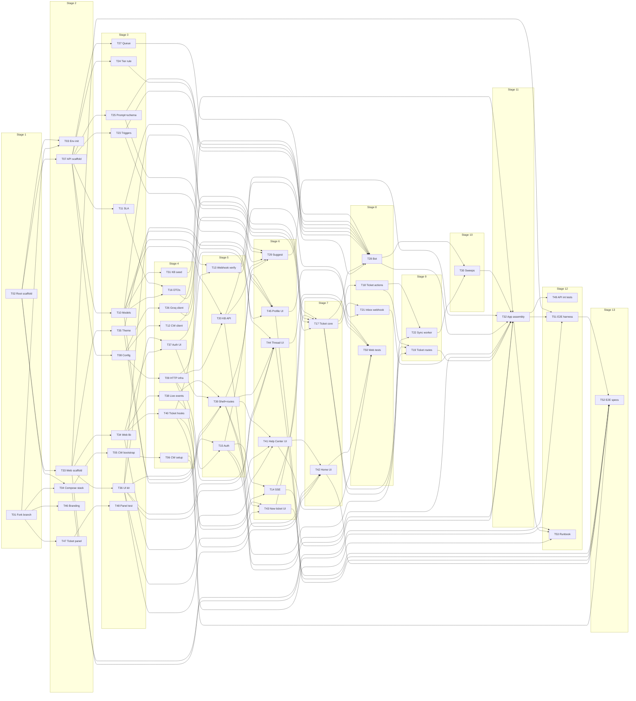
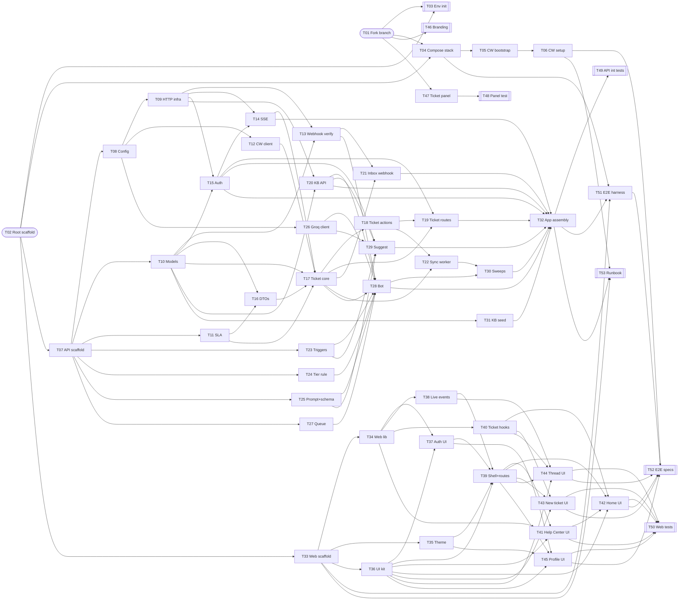

# Planning — Execution Plan (Stage 7, edited-plan-skill)

Input: lld-backend.md, lld-frontend.md, lld.md, lld-review.md (all APPROVED_WITH_FIXES in this run). The LLD is treated as the unmodifiable source of truth.
Machine-readable plan: `tasks.json` (53 tasks; each has `dependsOn`, `unlocks`, `stage`, `files`, `acceptance`, `requirements`, `designRef`).

Notes on the skill's hard boundaries:
- The skill forbids QA/testing tasks; the orchestrator explicitly requested test and e2e tasks (PLAN §8 Stage 10 needs them), so they are included as **code-writing** tasks (group G) with concrete acceptance checks. No QA strategy, timelines or estimates are included.
- Group letters reflect the requested execution order for a single sequential agent: **A** compose + Chatwoot fork setup → **B** API → **C** AI bot → **D** web → **E** seed → **F** Chatwoot fork customisations → **G** tests/e2e. Stages below are the true dependency layers; a sequential agent follows group order while never starting a task before its `dependsOn` are done (group order is consistent with the DAG except T31 seed, which T32 needs — run T31 before T32).
- Every REQ-001…REQ-049 is referenced by ≥ 1 task (checked by generator).

## 1. Task Breakdown

| Task ID | Task Name | Purpose | Input Dependencies | Output Produced | Files / Modules Affected |
|---|---|---|---|---|---|
| T01 | Fork branch from release tag | REQ-049 — hld-backend §16 | — | `git -C chatwoot rev-parse --abbrev-ref HEAD` = smartcc AND `git -C chatwoot describe --tags --exact-match HEAD` = v4.18.0 (or the latest v4.x tag present) AND `git -C chatwoot remote` lists upstream | `chatwoot/ (git branch smartcc)` |
| T02 | Root repo scaffold + .env.example | REQ-048 — lld-backend §4.8 | — | .env.example contains every api var in lld-backend §4.8 plus CW_ADMIN_EMAIL, CW_ADMIN_PASSWORD, CW_AGENT_EMAIL, CW_AGENT_PASSWORD, PORTAL_INTERNAL_URL, GROQ_API_KEY; .gitignore ignores .env, node_modules, chatwoot/.env | `.gitignore`<br>`.env.example`<br>`README.md` |
| T03 | Env initialiser script | REQ-048 — hld-backend §16 | T01, T02 | `node scripts/init-env.mjs` creates .env (JWT_SECRET 48 random chars) and chatwoot/.env (from chatwoot/.env.example with SECRET_KEY_BASE random hex, REDIS_PASSWORD, ENABLE_ACCOUNT_SIGNUP=false, SAFE_FETCH_ALLOW_PRIVATE_NETWORK=true, FRONTEND_URL=http://localhost:3000); second run changes nothing (existing keys preserved) | `scripts/init-env.mjs` |
| T04 | Root docker-compose.yml | REQ-048 — hld-backend §3/§16 | T01, T02 | `docker compose config --services` lists rails, sidekiq, vite, postgres, redis, mailhog, mongo, api, web; api depends_on mongo; web depends_on api; ports 3000, 4000, 5173 published; mongo volume named | `docker-compose.yml` |
| T05 | Chatwoot bootstrap runner | REQ-034, REQ-033, REQ-048 — lld-backend §6.9 | T04 | Run via `docker compose exec -T rails bundle exec rails runner -` twice: same account_id both times, prints JSON {account_id, admin_token}; InstallationConfig INSTALLATION_NAME=SmartCC and CAPTAIN_OPEN_AI_ENDPOINT=https://api.groq.com/openai present | `scripts/chatwoot-bootstrap.rb` |
| T06 | Chatwoot setup script (inbox, bot, attrs, labels, .env) | REQ-028, REQ-031, REQ-048 — lld-backend §6.9 | T05 | First run creates API inbox 'Customer Portal' (webhook_url http://api:4000/webhooks/chatwoot), agent bot 'SmartCC AI' attached, 5 conversation custom attributes, 11 labels; writes 6 CHATWOOT_* keys to .env and prints only token fingerprints; second run creates nothing new | `scripts/chatwoot-setup.mjs` |
| T07 | API package scaffold + constants | REQ-017 — lld-backend §2.1 | T02 | `npm ci && npx vitest run` exits 0 (no tests yet passes with --passWithNoTests); constants export the 7 categories, 4 priorities, 4 statuses, 8 triggers exactly as lld-backend §2.1 | `api/package.json`<br>`api/vitest.config.js`<br>`api/Dockerfile`<br>`api/src/constants.js` |
| T08 | Config loader (zod env) | REQ-044, REQ-048 — lld-backend §4.8 | T07 | Missing JWT_SECRET → process exits non-zero listing missing names; defaults applied per §4.8 table; MONGO_MEMORY=1 refused when NODE_ENV=production | `api/src/config.js` |
| T09 | HTTP infra: errors, logger, limiter, guards | REQ-002, REQ-044 — lld-backend §4.1/§4.5/§6.8 | T08 | Unit: limiter returns 429 with Retry-After on max+1; guard returns 415 for non-JSON POST and 403 for foreign Origin; error middleware maps AppError/ZodError/E11000(email) per §4.5; logger redacts authorization, api_access_token, cookie, password | `api/src/lib/errors.js`<br>`api/src/lib/log.js`<br>`api/src/lib/limit.js`<br>`api/src/lib/guards.js` |
| T10 | Mongoose models + indexes | REQ-004, REQ-046 — lld-backend §2.2 | T07 | Against mongodb-memory-server `syncIndexes()` creates every index in §2.2 (incl. partial uniques and TTL 604800 s); nextTicketNumber() returns SC-1001 then SC-1002 | `api/src/models/User.js`<br>`api/src/models/Ticket.js`<br>`api/src/models/Message.js`<br>`api/src/models/KbArticle.js`<br>`api/src/models/WebhookDelivery.js`<br>`api/src/models/Counter.js` |
| T11 | SLA module | REQ-024, REQ-025, REQ-027 — lld-backend §6.6 | T07 | `npx vitest run test/unit/sla.test.js` passes cases listed in lld-backend §8 (targets, 25 % boundary, breached, met/missed) | `api/src/sla/sla.js`<br>`api/test/unit/sla.test.js` |
| T12 | Chatwoot Application API client | REQ-028, REQ-030, REQ-032 — lld-backend §6.1 | T08 | Unit with stubbed fetch: each function hits the exact path/method/body of §6.1, sends api_access_token of the right token (admin vs bot), throws ChatwootError on non-2xx, aborts after CHATWOOT_TIMEOUT_MS; setCustomAttributes always sends merge:true | `api/src/chatwoot/client.js` |
| T13 | Webhook signature + receive pipeline | REQ-044, REQ-046 — lld-backend §5.1 | T09, T10 | Unit: valid sig passes; wrong secret, tampered body, ts older than 300 s, missing headers, non-hex → 401 codes; duplicate delivery id → 200 duplicate without calling handler; handler runs after response is sent | `api/src/chatwoot/signature.js`<br>`api/test/unit/signature.test.js` |
| T14 | SSE hub + /api/stream route | REQ-037, REQ-042, REQ-047 — lld-backend §4.6/§6.7 | T09, T15 | Integration: authenticated GET /api/stream returns text/event-stream with X-Accel-Buffering:no and `retry: 3000`; hub.emit(user) reaches only that user's connections; closed connection removed | `api/src/realtime/hub.js`<br>`api/src/realtime/routes.js` |
| T15 | Auth: session + routes E1–E6 | REQ-001, REQ-002, REQ-003, REQ-044 — lld-backend §4.3 E1–E6 | T09, T10 | Integration: register→201+cookie HttpOnly SameSite=Lax; duplicate → 409 EMAIL_TAKEN; login wrong → 401 INVALID_CREDENTIALS; 11th failed login → 429; password change → old cookie 401 (pv); logout → cookie cleared | `api/src/auth/session.js`<br>`api/src/auth/routes.js` |
| T16 | DTO mappers + status map | REQ-015, REQ-025 — lld-backend §4.2/§5.3 | T10, T11 | Unit: action flags and delivery derivation per §4.2; pending→ai_handling, open→in_progress, snoozed→waiting_on_customer, resolved→resolved, unknown→null; urgent↔critical | `api/src/tickets/dto.js`<br>`api/src/chatwoot/statusMap.js`<br>`api/test/unit/dto.test.js`<br>`api/test/unit/statusMap.test.js` |
| T17 | Ticket service core (create, sync, messages, state apply) | REQ-004, REQ-008, REQ-012, REQ-028, REQ-030, REQ-046 — lld-backend §6.2 | T10, T11, T12, T14, T16 | Integration with fake chatwoot: create → SC-1001, first message = description, conversation opener = subject+description with custom_attributes ticket_number; idempotent replay returns same ticket; Chatwoot error → delivery queued; applyConversationState ignores older updated_at; upsertChatwootMessage idempotent | `api/src/tickets/service.js` |
| T18 | Ticket actions (accept, handoff, resolve, rate) | REQ-009, REQ-010, REQ-011, REQ-013 — lld-backend §6.2 | T17 | Integration: accept only when canAccept else 409; handoff posts private note then toggle_status open with BOT token; resolve uses admin token; rate twice → 409 ALREADY_RATED; Chatwoot failure adds pendingActions and still returns 200 | `api/src/tickets/service.js (actions section)` |
| T19 | Ticket routes E7–E15 | REQ-006, REQ-007, REQ-008, REQ-009, REQ-010, REQ-011, REQ-013, REQ-044, REQ-045 — lld-backend §4.3 | T15, T17, T18 | Integration: all request/response bodies equal lld-backend §4.3 examples; foreign ticket → 404; list scope/cursor works; E10 triggers background reconcile at most once per 30 s | `api/src/tickets/routes.js` |
| T20 | KB retrieval + routes E16/E17 | REQ-035, REQ-018 — lld-backend §4.3 E16/E17, §6.5 | T09, T10 | Integration: `q=invoice` returns invoice article first; category filter; unknown slug 404; topArticles(query,3) returns ≤3 sorted by textScore | `api/src/kb/retrieve.js`<br>`api/src/kb/routes.js` |
| T21 | Inbox webhook handler E20 | REQ-029, REQ-030, REQ-042, REQ-046 — lld-backend §5.2–5.4 | T13, T17 | Integration (signed payloads): outgoing public → Message stored + SSE; private → ignored; incoming → ignored; duplicate delivery → ignored; urgent priority → critical + SLA recomputed; resolved → resolved/resolutionType human; lookup by ticket_number when conversationId missing | `api/src/chatwoot/webhook.js` |
| T22 | Sync worker: deferred delivery, pending actions, reconcile | REQ-004, REQ-008, REQ-045, REQ-046 — lld-backend §6.3 | T17, T18 | Integration: ticket created while fake Chatwoot fails becomes synced on tick after recovery; backoff 30 s ×20 then 5 min; pending message delivered; pendingActions replayed and pulled; reconcile inserts missing outgoing public messages only (message_type integer 1) | `api/src/sync/worker.js` |
| T23 | Keyword trigger scan + priority floor | REQ-020 — lld-backend §6.5 | T07 | Unit: each of 8 trigger lists hits; 'issue' does not trigger legal; floor critical for fraud/account_takeover/security/critical_incident, high otherwise | `api/src/ai/triggers.js`<br>`api/test/unit/triggers.test.js` |
| T24 | Tier decision function | REQ-019, REQ-020, REQ-021, REQ-023 — lld-backend §6.5 | T07 | Unit table in lld-backend §8 passes (incl. 0.85 exactly → draft, no source → draft, autoCount 2 → human) | `api/src/ai/tier.js`<br>`api/test/unit/tier.test.js` |
| T25 | LLM output schema + prompt builder | REQ-017, REQ-018 — lld-backend §6.5 | T07 | Unit: coercions per §6.5; prompt contains the verbatim system text, includes only provided article slugs, last 10 non-system messages, bodies truncated at 1500 chars, and the word JSON | `api/src/ai/schema.js`<br>`api/src/ai/prompt.js`<br>`api/test/unit/schema.test.js` |
| T26 | Groq client | REQ-021, REQ-041 — lld-backend §6.5 | T08 | Unit with stubbed fetch: sends model, temperature 0.2, response_format json_object; 429 then 200 → one retry honouring retry-after ≤5 s; 429 twice → AiError; missing key → AiError not_configured; timeout aborts | `api/src/ai/groq.js` |
| T27 | Per-ticket serial queue | REQ-023 — lld-backend §6.5 | T07 | Unit: two enqueues on same key run sequentially; different keys run concurrently; rejection does not break the chain; map entry removed after drain | `api/src/ai/queue.js` |
| T28 | Bot: webhook handler E21 + run() | REQ-016, REQ-017, REQ-018, REQ-019, REQ-020, REQ-021, REQ-022, REQ-023, REQ-032 — lld-backend §5.5/§6.5 | T13, T17, T20, T23, T24, T25, T26, T27 | Integration with fakes: auto path posts outgoing reply with bot token and stores AI message with sources; draft → private note + toggle open (bot); keyword trigger at conf 0.95 → human + priority floor; Groq failure → human ai_unavailable; unknown slug dropped → draft; decision fields persisted even if status webhook echo lands first; mid-run customer message gets its own run; Chatwoot failure during hand-off adds pendingActions 'handoff' | `api/src/ai/bot.js` |
| T29 | Suggest endpoint E18 | REQ-005 — lld-backend §4.3 E18 | T15, T20, T23, T25, T26 | Integration: answer returned only when conf ≥0.6, no triggers, ≥1 valid source; LLM failure → answer null + articles; 21st call/min → 429; logs evt suggestion_shown | `api/src/ai/suggest.js`<br>`api/src/ai/routes.js` |
| T30 | Worker sweeps: bot recovery + SLA breach | REQ-016, REQ-026 — lld-backend §6.3 | T22, T28 | Integration: ticket with pendingSince older than 60 s and synced is re-run once; breached open ticket gets breachedAt and label sla-breached merged once | `api/src/sync/worker.js (sweeps)` |
| T31 | KB seed content + seeder | REQ-036 — hld-backend §8.6 | T10 | ≥10 articles across 6 categories incl. slug payment-pending-subscription-not-active; `npm run seed` upserts by slug idempotently; text search for 'payment deducted plan inactive' ranks that article first | `api/src/seed/kb.js`<br>`api/src/seed/run.js` |
| T32 | App assembly + server boot + healthz | REQ-040, REQ-048 — lld-backend §4.8a | T14, T15, T19, T20, T21, T28, T29, T30, T31 | Raw-body webhook routes mounted before express.json (signed request verifies end-to-end); boot seeds KB when empty; GET /healthz returns ok/mongo/chatwoot/groq; SIGTERM shuts down cleanly | `api/src/app.js`<br>`api/src/server.js` |
| T33 | Web scaffold: Vite, TS, Tailwind tokens, fonts, proxy, Dockerfile | REQ-038, REQ-039, REQ-043 — lld-frontend §6/§18/§19 | T02 | `npm run build` succeeds; tokens.css has every token in lld-frontend §19 for light and dark; proxy /api → API with xfwd:true; inline pre-paint script sets data-theme | `web/package.json`<br>`web/vite.config.ts`<br>`web/tailwind.config.ts`<br>`web/postcss.config.js`<br>`web/tsconfig.json`<br>`web/index.html`<br>`web/src/styles/tokens.css`<br>`web/src/styles/index.css`<br>`web/Dockerfile` |
| T34 | Web lib: types, api client, query client, cache, format, validate, hooks | REQ-007, REQ-025 — lld-frontend §8/§11/§12 | T33 | `tsc --noEmit` clean; unit tests for upsertMessage (id, clientMessageId, order), countdown strings (§15a), validators pass; ApiError carries retryAfterS; global 401 handler skips ['me'] | `web/src/lib/types.ts`<br>`web/src/lib/api.ts`<br>`web/src/lib/queryClient.ts`<br>`web/src/lib/cache.ts`<br>`web/src/lib/format.ts`<br>`web/src/lib/validate.ts`<br>`web/src/lib/useNow.ts`<br>`web/src/lib/useDebounced.ts`<br>`web/test/lib.test.ts` |
| T35 | Theme provider + toggle | REQ-038 — lld-frontend §18 | T33 | Toggle cycles System→Light→Dark, persists localStorage scc-theme, System follows prefers-color-scheme live | `web/src/lib/theme.tsx`<br>`web/src/features/shell/ThemeToggle.tsx` |
| T36 | UI primitives | REQ-039, REQ-043 — lld-frontend §7 | T33 | RTL: Dialog uses native showModal and returns focus; SegmentedControl is a radio group with legend; Field wires aria-describedby/aria-invalid; all interactive elements ≥44 px | `web/src/ui/*.tsx (Button, Input, Textarea, Select, Card, Badge, Pill, SegmentedControl, Dialog, Skeleton, Toast, EmptyState, SlaRing, Field)` |
| T37 | Auth feature + Login/Register pages | REQ-001, REQ-002 — lld-frontend §7/§10 | T34, T36 | RTL: server details map to fields; EMAIL_TAKEN shown on email; next param only accepts ^/(?!/); successful login sets ['me'] and navigates | `web/src/features/auth/hooks.ts`<br>`web/src/features/auth/AuthForm.tsx`<br>`web/src/features/auth/RequireAuth.tsx`<br>`web/src/pages/LoginPage.tsx`<br>`web/src/pages/RegisterPage.tsx` |
| T38 | Live events hook | REQ-037 — lld-frontend §12 | T34 | Test with fake EventSource: message.created upserts once; ticket.updated sets ['ticket',n] and invalidates ['tickets']; reopen invalidates all queries | `web/src/lib/live.ts` |
| T39 | App shell, routes, main | REQ-002, REQ-039, REQ-043 — lld-frontend §5/§16/§17 | T35, T36, T37, T38 | Lazy routes per lld-frontend §6; signed-out /help renders without redirect; protected route redirects to /login?next=; route change focuses h1 and sets title; BottomTabs <768, SideNav ≥1280 | `web/src/main.tsx`<br>`web/src/routes.tsx`<br>`web/src/features/shell/AppShell.tsx`<br>`web/src/features/shell/TopBar.tsx`<br>`web/src/features/shell/SideNav.tsx`<br>`web/src/features/shell/BottomTabs.tsx`<br>`web/src/features/shell/ErrorBoundary.tsx`<br>`web/src/pages/NotFoundPage.tsx` |
| T40 | Ticket hooks | REQ-004, REQ-008 — lld-frontend §10 | T34 | Hook tests: useSendMessage optimistic insert → replace on success → failed on error → retry same clientMessageId; useCreateTicket sends Idempotency-Key; useTicket select | `web/src/features/tickets/hooks.ts` |
| T41 | KB hooks + Help pages | REQ-035 — lld-frontend §7 | T34, T36, T39 | Categories with counts; search; empty → Raise a ticket link with ?subject=; article body rendered as <p> text nodes; 404 panel | `web/src/features/kb/hooks.ts`<br>`web/src/features/kb/CategoryGrid.tsx`<br>`web/src/features/kb/ArticleList.tsx`<br>`web/src/features/kb/KbSearchBox.tsx`<br>`web/src/pages/HelpPage.tsx`<br>`web/src/pages/ArticlePage.tsx` |
| T42 | Home page | REQ-006, REQ-015, REQ-025 — lld-frontend §7/§15a | T36, T39, T40, T41 | Open/Resolved/All filter; empty state; SLA chip text+icon with aria-label; countdown ticks every 30 s | `web/src/pages/HomePage.tsx`<br>`web/src/features/tickets/TicketList.tsx`<br>`web/src/features/tickets/TicketCard.tsx`<br>`web/src/features/tickets/StatusPill.tsx`<br>`web/src/features/tickets/PriorityTag.tsx`<br>`web/src/features/tickets/SlaChip.tsx` |
| T43 | New ticket page + suggestion panel | REQ-004, REQ-005 — lld-frontend §7/§10 | T36, T39, T40 | Suggestion requested 800 ms after typing stops with description ≥20; stale request aborted; failure hides panel; double submit creates one ticket; navigates to thread | `web/src/pages/NewTicketPage.tsx`<br>`web/src/features/tickets/NewTicketForm.tsx`<br>`web/src/features/tickets/SuggestionPanel.tsx` |
| T44 | Ticket thread page | REQ-007, REQ-008, REQ-009, REQ-010, REQ-011, REQ-012, REQ-013, REQ-014, REQ-022, REQ-045 — lld-frontend §7/§15a | T36, T38, T39, T40 | Thread role=log; AI badge + sources; actions shown strictly per flags; Close behind dialog; CSAT once; composer enabled when resolved (reopen); Queued/Delayed banner; 'AI assistant is reviewing…' state | `web/src/pages/TicketPage.tsx`<br>`web/src/features/tickets/TicketHeader.tsx`<br>`web/src/features/tickets/DeliveryBanner.tsx`<br>`web/src/features/tickets/Thread.tsx`<br>`web/src/features/tickets/MessageBubble.tsx`<br>`web/src/features/tickets/AiMessage.tsx`<br>`web/src/features/tickets/SourceChips.tsx`<br>`web/src/features/tickets/Composer.tsx`<br>`web/src/features/tickets/TicketActions.tsx`<br>`web/src/features/tickets/CsatCard.tsx`<br>`web/src/features/tickets/DetailsPanel.tsx`<br>`web/src/features/tickets/StatusTimeline.tsx` |
| T45 | Profile page | REQ-003, REQ-038 — lld-frontend §7 | T35, T36, T37, T39 | Name update reflects in TopBar; WRONG_PASSWORD on current password field; theme selector present | `web/src/pages/ProfilePage.tsx`<br>`web/src/features/profile/ProfileForm.tsx`<br>`web/src/features/profile/PasswordForm.tsx` |
| T46 | Fork branding | REQ-033, REQ-049 — hld-backend §18.1 | T01 | Defaults INSTALLATION_NAME/BRAND_NAME = SmartCC; logos replaced; `git diff upstream/develop --stat` limited to these files plus T47 files | `chatwoot/config/installation_config.yml`<br>`chatwoot/public/brand-assets/logo.svg`<br>`chatwoot/public/brand-assets/logo_dark.svg`<br>`chatwoot/public/brand-assets/logo_thumbnail.svg` |
| T47 | Portal ticket sidebar panel | REQ-031 — hld-backend §18.2 | T01 | Panel 'Portal ticket' appears first in conversation sidebar for conversations with custom_attributes.ticket_number; shows ticket number, SLA due (local time + relative), AI tier, AI confidence %, CSAT or '—'; hidden when ticket_number absent | `chatwoot/app/javascript/dashboard/routes/dashboard/conversation/PortalTicketPanel.vue`<br>`chatwoot/app/javascript/dashboard/routes/dashboard/conversation/ContactPanel.vue`<br>`chatwoot/app/javascript/dashboard/composables/useUISettings.js`<br>`chatwoot/app/javascript/dashboard/i18n/locale/en/conversation.json` |
| T48 | Panel spec test | REQ-031 — hld-backend §18.2 | T47 | `pnpm vitest run PortalTicketPanel` (inside chatwoot) passes: renders values from custom_attributes; renders nothing without ticket_number | `chatwoot/app/javascript/dashboard/routes/dashboard/conversation/specs/PortalTicketPanel.spec.js` |
| T49 | API integration test suite | REQ-046, REQ-044 — lld-backend §8 | T32 | `npx vitest run test/int` passes all scenarios in lld-backend §8 Integration list | `api/test/int/*.test.js`<br>`api/test/helpers/fakes.js` |
| T50 | Web component/integration tests | REQ-043 — lld-frontend §22 | T41, T42, T43, T44, T45 | `npx vitest run` in web passes scenarios in lld-frontend §22 | `web/test/*.test.tsx` |
| T51 | E2E harness: Groq stub + compose override + Playwright config | REQ-041 — tech-stack e2e | T04, T32, T33 | `docker compose -f docker-compose.yml -f docker-compose.e2e.yml up` routes GROQ_URL to the stub; stub returns auto-tier JSON for 'payment pending' text and draft-tier JSON for text containing 'refund' | `e2e/package.json`<br>`e2e/playwright.config.ts`<br>`e2e/groq-stub.mjs`<br>`docker-compose.e2e.yml` |
| T52 | E2E specs: demo flow, handoff+agent reply, a11y, mobile | REQ-009, REQ-013, REQ-016, REQ-029, REQ-030, REQ-037, REQ-039, REQ-042, REQ-043 — PLAN §9 | T06, T42, T43, T44, T45, T51 | Specs pass: (1) register → create 'Payment deducted but plan inactive' → AI answer with source appears → This solved it → Resolved → CSAT 5; (2) refund ticket → draft → In progress; agent reply posted via Chatwoot API with agent token appears ≤5 s without reload; agent resolves → Resolved → CSAT; (3) axe 0 serious/critical on all pages light+dark; 360 px no horizontal scroll | `e2e/tests/demo.spec.ts`<br>`e2e/tests/handoff.spec.ts`<br>`e2e/tests/a11y.spec.ts` |
| T53 | Runbook in README | REQ-048 — hld-backend §16 | T06, T32, T33 | README lists exact sequence: init-env → docker compose up -d → db:chatwoot_prepare → chatwoot-setup → restart api → open :5173 and :3000, plus demo steps of PLAN §9 and troubleshooting (SAFE_FETCH, 4 GB RAM) | `README.md` |

## 2. Dependency Matrix

| Task | Depends On | Unlocks | Dependency Type |
|---|---|---|---|
| T01 | — | T03, T04, T46, T47 | Independent |
| T02 | — | T03, T04, T07, T33 | Independent |
| T03 | T01, T02 | — | Hard Dependency |
| T04 | T01, T02 | T05, T51 | Hard Dependency |
| T05 | T04 | T06 | Hard Dependency |
| T06 | T05 | T52, T53 | Hard Dependency |
| T07 | T02 | T08, T10, T11, T23, T24, T25, T27 | Hard Dependency |
| T08 | T07 | T09, T12, T26 | Hard Dependency |
| T09 | T08 | T13, T14, T15, T20 | Hard Dependency |
| T10 | T07 | T13, T15, T16, T17, T20, T31 | Hard Dependency |
| T11 | T07 | T16, T17 | Hard Dependency |
| T12 | T08 | T17 | Hard Dependency |
| T13 | T09, T10 | T21, T28 | Hard Dependency |
| T14 | T09, T15 | T17, T32 | Hard Dependency |
| T15 | T09, T10 | T14, T19, T29, T32 | Hard Dependency |
| T16 | T10, T11 | T17 | Hard Dependency |
| T17 | T10, T11, T12, T14, T16 | T18, T19, T21, T22, T28 | Hard Dependency |
| T18 | T17 | T19, T22 | Hard Dependency |
| T19 | T15, T17, T18 | T32 | Hard Dependency |
| T20 | T09, T10 | T28, T29, T32 | Hard Dependency |
| T21 | T13, T17 | T32 | Hard Dependency |
| T22 | T17, T18 | T30 | Hard Dependency |
| T23 | T07 | T28, T29 | Hard Dependency |
| T24 | T07 | T28 | Hard Dependency |
| T25 | T07 | T28, T29 | Hard Dependency |
| T26 | T08 | T28, T29 | Hard Dependency |
| T27 | T07 | T28 | Hard Dependency |
| T28 | T13, T17, T20, T23, T24, T25, T26, T27 | T30, T32 | Hard Dependency |
| T29 | T15, T20, T23, T25, T26 | T32 | Hard Dependency |
| T30 | T22, T28 | T32 | Hard Dependency |
| T31 | T10 | T32 | Hard Dependency |
| T32 | T14, T15, T19, T20, T21, T28, T29, T30, T31 | T49, T51, T53 | Hard Dependency |
| T33 | T02 | T34, T35, T36, T51, T53 | Hard Dependency |
| T34 | T33 | T37, T38, T40, T41 | Hard Dependency |
| T35 | T33 | T39, T45 | Hard Dependency |
| T36 | T33 | T37, T39, T41, T42, T43, T44, T45 | Hard Dependency |
| T37 | T34, T36 | T39, T45 | Hard Dependency |
| T38 | T34 | T39, T44 | Hard Dependency |
| T39 | T35, T36, T37, T38 | T41, T42, T43, T44, T45 | Hard Dependency |
| T40 | T34 | T42, T43, T44 | Hard Dependency |
| T41 | T34, T36, T39 | T42, T50 | Hard Dependency |
| T42 | T36, T39, T40, T41 | T50, T52 | Hard Dependency |
| T43 | T36, T39, T40 | T50, T52 | Hard Dependency |
| T44 | T36, T38, T39, T40 | T50, T52 | Hard Dependency |
| T45 | T35, T36, T37, T39 | T50, T52 | Hard Dependency |
| T46 | T01 | — | Hard Dependency |
| T47 | T01 | T48 | Hard Dependency |
| T48 | T47 | — | Hard Dependency |
| T49 | T32 | — | Hard Dependency |
| T50 | T41, T42, T43, T44, T45 | — | Hard Dependency |
| T51 | T04, T32, T33 | T52 | Hard Dependency |
| T52 | T06, T42, T43, T44, T45, T51 | — | Hard Dependency |
| T53 | T06, T32, T33 | — | Hard Dependency |

## 3. Execution Stages (Topological Layering)

- **Stage 1**: T01 Fork branch, T02 Root scaffold
- **Stage 2**: T03 Env init, T04 Compose stack, T07 API scaffold, T33 Web scaffold, T46 Branding, T47 Ticket panel
- **Stage 3**: T05 CW bootstrap, T08 Config, T10 Models, T11 SLA, T23 Triggers, T24 Tier rule, T25 Prompt+schema, T27 Queue, T34 Web lib, T35 Theme, T36 UI kit, T48 Panel test
- **Stage 4**: T06 CW setup, T09 HTTP infra, T12 CW client, T16 DTOs, T26 Groq client, T31 KB seed, T37 Auth UI, T38 Live events, T40 Ticket hooks
- **Stage 5**: T13 Webhook verify, T15 Auth, T20 KB API, T39 Shell+routes
- **Stage 6**: T14 SSE, T29 Suggest, T41 Help Center UI, T43 New ticket UI, T44 Thread UI, T45 Profile UI
- **Stage 7**: T17 Ticket core, T42 Home UI
- **Stage 8**: T18 Ticket actions, T21 Inbox webhook, T28 Bot, T50 Web tests
- **Stage 9**: T19 Ticket routes, T22 Sync worker
- **Stage 10**: T30 Sweeps
- **Stage 11**: T32 App assembly
- **Stage 12**: T49 API int tests, T51 E2E harness, T53 Runbook
- **Stage 13**: T52 E2E specs

## 4. Critical Path

T02 (Root scaffold) → T07 (API scaffold) → T08 (Config) → T09 (HTTP infra) → T15 (Auth) → T14 (SSE) → T17 (Ticket core) → T18 (Ticket actions) → T22 (Sync worker) → T30 (Sweeps) → T32 (App assembly) → T51 (E2E harness) → T52 (E2E specs)

Length: 13 sequential tasks. It is critical because the end-to-end demo specs (T52) need the assembled API (T32), which needs the ticket service, actions, sync worker and sweeps chained on auth and HTTP infra. A delay anywhere on it delays: T49 (API integration tests), T51/T52 (e2e) and T53 (runbook).
Downstream tasks blocked by critical-path delays: T03, T04, T05, T06, T10, T11, T12, T13, T16, T19, T20, T21, T23, T24, T25, T26, T27, T28, T29, T31, T33, T34, T35, T36, T37, T38, T39, T40, T41, T42, T43, T44, T45, T49, T50, T53.

## 5. Optimized Execution Plan

**Sequential Execution Path:** T02 → T07 → T08 → T09 → T15 → T14 → T17 → T18 → T22 → T30 → T32 → T51 → T52

**Parallel Execution Sets:**
- Stage 1: {T01, T02}
- Stage 2: {T03, T04, T07, T33, T46, T47}
- Stage 3: {T05, T08, T10, T11, T23, T24, T25, T27, T34, T35, T36, T48}
- Stage 4: {T06, T09, T12, T16, T26, T31, T37, T38, T40}
- Stage 5: {T13, T15, T20, T39}
- Stage 6: {T14, T29, T41, T43, T44, T45}
- Stage 7: {T17, T42}
- Stage 8: {T18, T21, T28, T50}
- Stage 9: {T19, T22}
- Stage 10: {T30}
- Stage 11: {T32}
- Stage 12: {T49, T51, T53}
- Stage 13: {T52}

## 6. Layered Mermaid DAG



## 7. Professional Dependency Graph

Roots (no dependencies): T01, T02. Terminals (unlock nothing): T03, T46, T48, T49, T50, T52, T53.



## 8. Visual Execution Flow

```text
🚀 Stage 1 (Start)
├── T01 Fork branch from release tag
└── T02 Root repo scaffold + .env.example

        │
        ▼

⚙️ Stage 2
├── T03 Env initialiser script
├── T04 Root docker-compose.yml
├── T07 API package scaffold + constants
├── T33 Web scaffold: Vite, TS, Tailwind tokens, fonts, proxy, Dockerfile
├── T46 Fork branding
└── T47 Portal ticket sidebar panel

        │
        ▼

⚙️ Stage 3
├── T05 Chatwoot bootstrap runner
├── T08 Config loader (zod env)
├── T10 Mongoose models + indexes
├── T11 SLA module
├── T23 Keyword trigger scan + priority floor
├── T24 Tier decision function
├── T25 LLM output schema + prompt builder
├── T27 Per-ticket serial queue
├── T34 Web lib: types, api client, query client, cache, format, validate, hooks
├── T35 Theme provider + toggle
├── T36 UI primitives
└── T48 Panel spec test

        │
        ▼

⚙️ Stage 4
├── T06 Chatwoot setup script (inbox, bot, attrs, labels, .env)
├── T09 HTTP infra: errors, logger, limiter, guards
├── T12 Chatwoot Application API client
├── T16 DTO mappers + status map
├── T26 Groq client
├── T31 KB seed content + seeder
├── T37 Auth feature + Login/Register pages
├── T38 Live events hook
└── T40 Ticket hooks

        │
        ▼

⚙️ Stage 5
├── T13 Webhook signature + receive pipeline
├── T15 Auth: session + routes E1–E6
├── T20 KB retrieval + routes E16/E17
└── T39 App shell, routes, main

        │
        ▼

⚙️ Stage 6
├── T14 SSE hub + /api/stream route
├── T29 Suggest endpoint E18
├── T41 KB hooks + Help pages
├── T43 New ticket page + suggestion panel
├── T44 Ticket thread page
└── T45 Profile page

        │
        ▼

⚙️ Stage 7
├── T17 Ticket service core (create, sync, messages, state apply)
└── T42 Home page

        │
        ▼

⚙️ Stage 8
├── T18 Ticket actions (accept, handoff, resolve, rate)
├── T21 Inbox webhook handler E20
├── T28 Bot: webhook handler E21 + run()
└── T50 Web component/integration tests

        │
        ▼

⚙️ Stage 9
├── T19 Ticket routes E7–E15
└── T22 Sync worker: deferred delivery, pending actions, reconcile

        │
        ▼

⚙️ Stage 10
└── T30 Worker sweeps: bot recovery + SLA breach

        │
        ▼

⚙️ Stage 11
└── T32 App assembly + server boot + healthz

        │
        ▼

⚙️ Stage 12
├── T49 API integration test suite
├── T51 E2E harness: Groq stub + compose override + Playwright config
└── T53 Runbook in README

        │
        ▼

✅ Stage 13 (Final Assembly)
└── T52 E2E specs: demo flow, handoff+agent reply, a11y, mobile
```

## 9. Structured Architecture Execution Graph (Spark DAG)

```text
                                                              STAGE 1                                                               
+------------------------------+   +------------------------------+
| T01                          |   | T02                          |
| Fork branch                  |   | Root scaffold                |
| needs:root                   |   | needs:root                   |
+------------------------------+   +------------------------------+
                                                                 │                                                                  
                                                                 ▼                                                                  
                                                              STAGE 2                                                               
+------------------------------+   +------------------------------+   +------------------------------+   +------------------------------+
| T03                          |   | T04                          |   | T07                          |   | T33                          |
| Env init                     |   | Compose stack                |   | API scaffold                 |   | Web scaffold                 |
| needs:T01,T02                |   | needs:T01,T02                |   | needs:T02                    |   | needs:T02                    |
+------------------------------+   +------------------------------+   +------------------------------+   +------------------------------+
+------------------------------+   +------------------------------+
| T46                          |   | T47                          |
| Branding                     |   | Ticket panel                 |
| needs:T01                    |   | needs:T01                    |
+------------------------------+   +------------------------------+
                                                                 │                                                                  
                                                                 ▼                                                                  
                                                              STAGE 3                                                               
+------------------------------+   +------------------------------+   +------------------------------+   +------------------------------+
| T05                          |   | T08                          |   | T10                          |   | T11                          |
| CW bootstrap                 |   | Config                       |   | Models                       |   | SLA                          |
| needs:T04                    |   | needs:T07                    |   | needs:T07                    |   | needs:T07                    |
+------------------------------+   +------------------------------+   +------------------------------+   +------------------------------+
+------------------------------+   +------------------------------+   +------------------------------+   +------------------------------+
| T23                          |   | T24                          |   | T25                          |   | T27                          |
| Triggers                     |   | Tier rule                    |   | Prompt+schema                |   | Queue                        |
| needs:T07                    |   | needs:T07                    |   | needs:T07                    |   | needs:T07                    |
+------------------------------+   +------------------------------+   +------------------------------+   +------------------------------+
+------------------------------+   +------------------------------+   +------------------------------+   +------------------------------+
| T34                          |   | T35                          |   | T36                          |   | T48                          |
| Web lib                      |   | Theme                        |   | UI kit                       |   | Panel test                   |
| needs:T33                    |   | needs:T33                    |   | needs:T33                    |   | needs:T47                    |
+------------------------------+   +------------------------------+   +------------------------------+   +------------------------------+
                                                                 │                                                                  
                                                                 ▼                                                                  
                                                              STAGE 4                                                               
+------------------------------+   +------------------------------+   +------------------------------+   +------------------------------+
| T06                          |   | T09                          |   | T12                          |   | T16                          |
| CW setup                     |   | HTTP infra                   |   | CW client                    |   | DTOs                         |
| needs:T05                    |   | needs:T08                    |   | needs:T08                    |   | needs:T10,T11                |
+------------------------------+   +------------------------------+   +------------------------------+   +------------------------------+
+------------------------------+   +------------------------------+   +------------------------------+   +------------------------------+
| T26                          |   | T31                          |   | T37                          |   | T38                          |
| Groq client                  |   | KB seed                      |   | Auth UI                      |   | Live events                  |
| needs:T08                    |   | needs:T10                    |   | needs:T34,T36                |   | needs:T34                    |
+------------------------------+   +------------------------------+   +------------------------------+   +------------------------------+
+------------------------------+
| T40                          |
| Ticket hooks                 |
| needs:T34                    |
+------------------------------+
                                                                 │                                                                  
                                                                 ▼                                                                  
                                                              STAGE 5                                                               
+------------------------------+   +------------------------------+   +------------------------------+   +------------------------------+
| T13                          |   | T15                          |   | T20                          |   | T39                          |
| Webhook verify               |   | Auth                         |   | KB API                       |   | Shell+routes                 |
| needs:T09,T10                |   | needs:T09,T10                |   | needs:T09,T10                |   | needs:T35,T36,T37,T38        |
+------------------------------+   +------------------------------+   +------------------------------+   +------------------------------+
                                                                 │                                                                  
                                                                 ▼                                                                  
                                                              STAGE 6                                                               
+------------------------------+   +------------------------------+   +------------------------------+   +------------------------------+
| T14                          |   | T29                          |   | T41                          |   | T43                          |
| SSE                          |   | Suggest                      |   | Help Center UI               |   | New ticket UI                |
| needs:T09,T15                |   | needs:T15,T20,T23,T25,T26    |   | needs:T34,T36,T39            |   | needs:T36,T39,T40            |
+------------------------------+   +------------------------------+   +------------------------------+   +------------------------------+
+------------------------------+   +------------------------------+
| T44                          |   | T45                          |
| Thread UI                    |   | Profile UI                   |
| needs:T36,T38,T39,T40        |   | needs:T35,T36,T37,T39        |
+------------------------------+   +------------------------------+
                                                                 │                                                                  
                                                                 ▼                                                                  
                                                              STAGE 7                                                               
+------------------------------+   +------------------------------+
| T17                          |   | T42                          |
| Ticket core                  |   | Home UI                      |
| needs:T10,T11,T12,T14,T16    |   | needs:T36,T39,T40,T41        |
+------------------------------+   +------------------------------+
                                                                 │                                                                  
                                                                 ▼                                                                  
                                                              STAGE 8                                                               
+------------------------------+   +------------------------------+   +------------------------------+   +------------------------------+
| T18                          |   | T21                          |   | T28                          |   | T50                          |
| Ticket actions               |   | Inbox webhook                |   | Bot                          |   | Web tests                    |
| needs:T17                    |   | needs:T13,T17                |   | needs:T13,T17,T20,T23,T24,T2 |   | needs:T41,T42,T43,T44,T45    |
|                              |   |                              |   | 5,T26,T27                    |   |                              |
+------------------------------+   +------------------------------+   +------------------------------+   +------------------------------+
                                                                 │                                                                  
                                                                 ▼                                                                  
                                                              STAGE 9                                                               
+------------------------------+   +------------------------------+
| T19                          |   | T22                          |
| Ticket routes                |   | Sync worker                  |
| needs:T15,T17,T18            |   | needs:T17,T18                |
+------------------------------+   +------------------------------+
                                                                 │                                                                  
                                                                 ▼                                                                  
                                                              STAGE 10                                                              
+------------------------------+
| T30                          |
| Sweeps                       |
| needs:T22,T28                |
+------------------------------+
                                                                 │                                                                  
                                                                 ▼                                                                  
                                                              STAGE 11                                                              
+------------------------------+
| T32                          |
| App assembly                 |
| needs:T14,T15,T19,T20,T21,T2 |
| 8,T29,T30,T31                |
+------------------------------+
                                                                 │                                                                  
                                                                 ▼                                                                  
                                                              STAGE 12                                                              
+------------------------------+   +------------------------------+   +------------------------------+
| T49                          |   | T51                          |   | T53                          |
| API int tests                |   | E2E harness                  |   | Runbook                      |
| needs:T32                    |   | needs:T04,T32,T33            |   | needs:T06,T32,T33            |
+------------------------------+   +------------------------------+   +------------------------------+
                                                                 │                                                                  
                                                                 ▼                                                                  
                                                              STAGE 13                                                              
+------------------------------+
| T52                          |
| E2E specs                    |
| needs:T06,T42,T43,T44,T45,T5 |
| 1                            |
+------------------------------+
```

---

## Self-Validation Checklist
- [x] 1. Task Breakdown exists and is complete (53 rows).
- [x] 2. Dependency Matrix exists with valid dependency types.
- [x] 3. Execution Stages exist; every task in exactly one stage (13 stages).
- [x] 4. Critical Path exists with ordered sequence.
- [x] 5. Optimized Execution Plan exists (sequential + parallel sets).
- [x] 6. Structured Architecture Execution Graph (ASCII) exists inside a text block; third box line lists exact dependencies so the graph is lossless.
