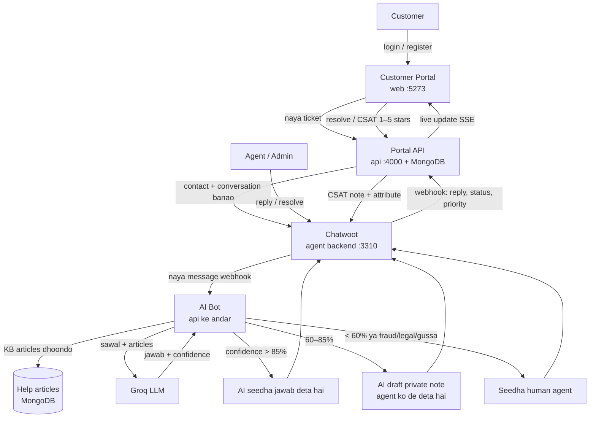
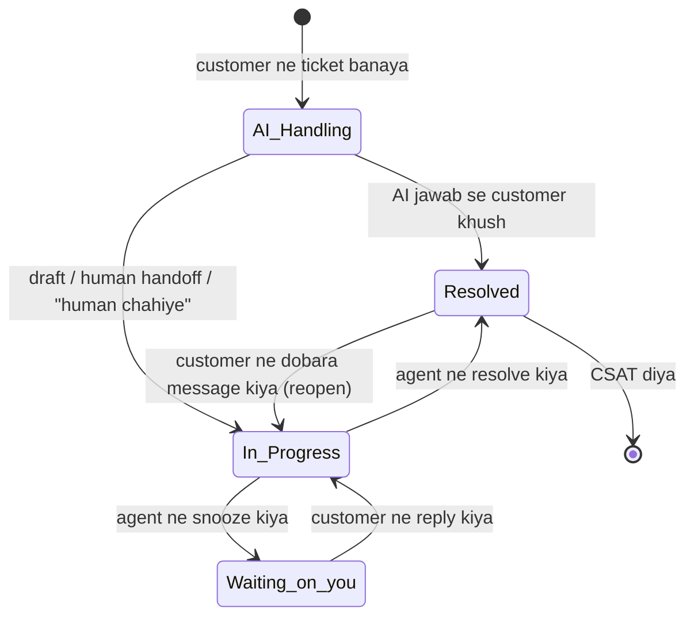
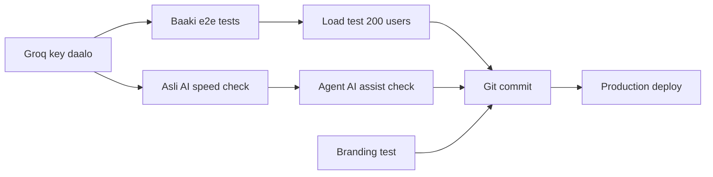

# SmartCC — Flow (kya bana hai, kya baaki hai)

## 1. Poora flow (end to end)

## 2. Ticket ki zindagi (status)

## 3. Kya bana hai (DONE)

| Hissa | Kya karta hai | Status |
|---|---|---|
| Customer portal (web) | Login, register, ticket banana, ticket list, chat thread, help center, profile, light/dark, mobile | ✅ Done |
| Live updates | Agent ka reply bina refresh ke dikhta hai (SSE) | ✅ Done |
| AI suggestion | Ticket likhte waqt hi AI possible jawab dikhata hai | ✅ Done |
| Portal API | Auth, tickets, messages, KB search, rate limit, SLA timer | ✅ Done |
| Chatwoot sync | Ticket → conversation, reply/status/priority wapas portal me, duplicate se bachav, retry worker | ✅ Done |
| AI bot | Groq se jawab, 3-tier rule (auto / draft / human), fraud-legal-gussa pe seedha human | ✅ Done |
| SLA | Critical 15 min, High 1 hr, Medium 4 hr, Low 24 hr; breach pe label | ✅ Done |
| CSAT | 1–5 star rating, Chatwoot me bhi dikhta hai | ✅ Done |
| Chatwoot fork | SmartCC branding + "Portal ticket" side panel (ticket no., SLA, AI tier, confidence, CSAT) | ✅ Done |
| Security | Webhook signature check, sirf apna ticket, ports localhost, logs me secret hidden | ✅ Done |
| Tests | API 127, web 41, fork panel 3, e2e 3 (demo, handoff, accessibility+mobile) — sab pass | ✅ Done |
| Docker setup | `docker compose up` se sab chalu, setup scripts, README runbook | ✅ Done |

## 4. Kya baaki hai (PENDING)

| # | Kaam | Kyun zaroori | Kaun karega |
|---|---|---|---|
| P1 | `.env` me `GROQ_API_KEY` daalna, api ko asli Groq pe chalana | Abhi AI test-stub pe chal raha hai | User |
| P2 | Asli Groq ke saath AI speed check (target: 15 sec me jawab) | Sirf stub se test hua | Team |
| P3 | 200 users ka load / performance test | Abhi nahi hua | Team |
| P4 | E2E test: reopen, status timeline, live reconnect | Abhi sirf API level pe test hai | Team |
| P5 | Agent AI assist (summary / reply suggestion) ko Groq pe check karna | Test nahi hua | Team |
| P6 | Branding + fork boundary ke liye automatic test | Sirf manually dekha | Team |
| P7 | Git commit (root repo + chatwoot `smartcc` branch) | Abhi kuch commit nahi | User bole tab |
| P8 | Production deploy (HTTPS, domain, asli passwords, backup) | Abhi sirf local dev setup | Team |
| P9 | Chhoti limit: Chatwoot har step pe ~10 sec atke to bahut kam chance me duplicate ticket | Rare case | Team (baad me) |
| P10 | Sync sirf aakhri ~20 messages dekhta hai | Purana lost event wapas nahi aata | Team (baad me) |

## 5. Pending ka flow (aage kya karna hai)

